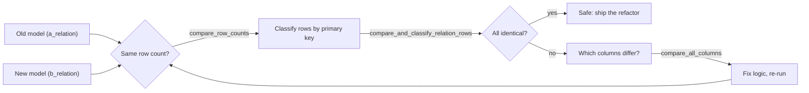

# dbt audit_helper: Reading Guide (with worked example)

Goal: prove that a changed model produces the same data as the old one, instead of eyeballing it.
Tags: **Fact** = from the package README / dbt docs. **Hypothesis** = reasoned, not verified. **Unknown** = must test.
All numbers in the example below are **illustrative**, not from your repo.

## Outline
1. Big picture
2. Install
3. Macro cheat sheet
4. The standard workflow (6 steps)
5. Worked example: `fact_order` table -> incremental, step by step
6. How to read the output (decision table)
7. M2 use: proving an incremental model
8. Caveats and troubleshooting
9. Check yourself

---

## 1. Big picture

**Problem:** you refactor a model (new SQL, table -> incremental, new join). Tests like `unique` and `not_null` tell you the data is *valid*, not that it is *unchanged*. audit_helper answers: "is the new output the same as the old output?"

**Mental model:** a diff tool for tables. Old vs new, row by row, column by column.

**Where it lives:** during development and validation, not in production runs. It is a one-off proof, saved as evidence (e.g. `docs/incremental_proof.md`).

**Use when:** refactoring, migrating a legacy query to dbt, changing materialization, changing logic that should not change numbers.
**Don't use when:** the new model is *supposed* to change numbers (then you compare only to measure the size of the change), or for ongoing monitoring (use tests or observability tools).



## 2. Install

```yaml
# packages.yml
packages:
  - package: dbt-labs/audit_helper
    version: [">=0.12.0", "<1.0.0"]   # Hypothesis: check hub.getdbt.com for the current range
```
Then `dbt deps`. Fact: it is a macro package, nothing is materialized by default.

## 3. Macro cheat sheet

| Macro | Answers | Use it |
|---|---|---|
| `compare_row_counts` | Do both have the same number of rows? | First, cheapest check |
| `compare_relation_columns` | Same column names / order / types? | Schema-level check |
| `compare_and_classify_relation_rows` | Per row: identical / modified / added / removed (and non-unique PK) | Main check; needs a primary key |
| `compare_all_columns` | Per column: how many rows match vs differ | After rows differ: find the culprit column |
| `compare_column_values` | For one column: match / mismatch / null breakdown | Zoom into one column |
| `quick_are_relations_identical` | Yes/No via hashing, no detail | Fast gate on big tables (platform-dependent, Unknown on DuckDB) |
| `compare_queries` and `compare_which_*` variants | Same checks on arbitrary queries, not just relations | Compare against legacy SQL not in dbt, or a date-filtered subset |

Fact: common arguments are `a_relation`, `b_relation`, a primary key argument, `exclude_columns`, and `summarize` (summary counts vs row-level output).
Hypothesis: the PK argument is `primary_key_columns` in recent versions and `primary_key` in older ones. Open the README of the version you installed and copy the exact names.

## 4. The standard workflow

1. Keep the old model alive under another name (`fact_order_old`) or point at a prod relation.
2. Build the new model.
3. `compare_row_counts`. If counts differ, stop and explain why.
4. `compare_and_classify_relation_rows` with `summarize = true`. You want 100% identical.
5. If not, `compare_all_columns` to find which columns differ, then inspect a few `modified` rows.
6. Fix, rebuild, repeat. Save the final output as evidence.

**Common mistake:** wrong or non-unique primary key. Rows then explode or get misclassified. Check PK uniqueness first.
**Common mistake:** comparing columns that legitimately differ (`updated_at`, load timestamps). Use `exclude_columns`.

## 5. Worked example: `fact_order` table -> incremental

Scenario: `fact_order` is a `table` today. You rewrite it as `incremental` with a 3-day lookback and want proof it did not change the numbers.

### Step 0: Freeze the old version as the reference

Copy the current model SQL into a new model that stays a full table:

```sql
-- models/audit/fact_order_old.sql
{{ config(materialized='table') }}

-- paste the ORIGINAL fact_order SQL here, unchanged
select ...
```
Then rewrite `models/.../fact_order.sql` as the new incremental version.

Why: you need two relations to compare. The old one is your ground truth.

### Step 1: Install the package

Add it to `packages.yml` (section 2), then:
```bash
dbt deps
```
Check: a folder `dbt_packages/audit_helper/` now exists.

### Step 2: Build both models

```bash
dbt run -s fact_order_old fact_order
```
Check: both relations exist in DuckDB. (First run of the incremental model does a full build, so it should already match. The real test comes in Step 6.)

### Step 3: Row-count check

```sql
-- analyses/audit_1_row_counts.sql
{{ audit_helper.compare_row_counts(
    a_relation = ref('fact_order_old'),
    b_relation = ref('fact_order')
) }}
```
Run it:
```bash
dbt show -s audit_1_row_counts
```
Hypothesis: `dbt show` works on analyses. If it errors, use the fallback: `dbt compile -s audit_1_row_counts`, then open the compiled SQL under `target/compiled/<project>/analyses/` and run it in DuckDB yourself.

Illustrative output:

| relation | row_count |
|---|---|
| fact_order_old | 1,000,000 |
| fact_order | 999,880 |

Read: 120 rows missing in the new model. Do not go further until you can explain 120. Likely suspects: a filter you changed, an inner join that dropped rows, or late data outside the lookback.

### Step 4: Classify rows

```sql
-- analyses/audit_2_classify.sql
{{ audit_helper.compare_and_classify_relation_rows(
    a_relation = ref('fact_order_old'),
    b_relation = ref('fact_order'),
    primary_key_columns = ['order_id'],
    summarize = true
) }}
```
```bash
dbt show -s audit_2_classify
```
Illustrative output (column names are Hypothesis, check yours):

| status | count | share |
|---|---|---|
| identical | 999,700 | 99.97% |
| modified | 180 | 0.02% |
| removed | 120 | 0.01% |
| added | 0 | 0% |

Read, in this vocabulary:
- **identical**: same PK, all compared columns equal. Good.
- **modified**: same PK, at least one column differs.
- **removed**: PK exists in old (a) but not in new (b).
- **added**: PK exists in new (b) but not in old (a).

Here: 120 removed matches the row-count gap from Step 3. 180 modified needs a column-level look.

### Step 5: Find which column differs

```sql
-- analyses/audit_3_columns.sql
{{ audit_helper.compare_all_columns(
    a_relation = ref('fact_order_old'),
    b_relation = ref('fact_order'),
    primary_key = 'order_id'
) }}
```
Illustrative output: every column shows 100% match except `discount_amount`, 180 mismatches.

Then look at a few real rows with plain SQL:
```sql
select o.order_id, o.discount_amount as old_val, n.discount_amount as new_val
from fact_order_old o
join fact_order n using (order_id)
where o.discount_amount is distinct from n.discount_amount
limit 20;
```
Typical findings: rounding (`12.5` vs `12.49999`), a NULL that became 0, a timezone shift on a timestamp.

### Step 6: Fix, then test the incremental behavior itself

1. Fix the formula, rebuild: `dbt run -s fact_order --full-refresh`, then repeat Steps 3 to 5 until `identical` is 100%.
2. Now test the thing that makes incremental different: simulate new and late data in the source (or just run again later), then:
   ```bash
   dbt run -s fact_order            # incremental run, NOT full refresh
   dbt run -s fact_order_old        # rebuild old from the same source
   ```
   Re-run Steps 3 and 4.
3. Expect identical, or small differences that fall outside the 3-day lookback window. Those are the late-arriving rows, and they are the argument for a periodic full refresh.

### Step 7: Save the evidence

Create `docs/incremental_proof.md` with:
- Row counts before/after
- Classification summary (the table from Step 4)
- What you fixed and why
- Build runtime: old table vs new incremental (this is the payoff)
- Known drift and the full-refresh cadence you chose

That file is your portfolio artifact.

## 6. How to read the output (decision table)

| You see | Meaning | Next move |
|---|---|---|
| Counts equal, all identical | Equivalent | Ship, save evidence |
| Counts differ, `removed` > 0 | New model lost rows | Check filters, joins, lookback window |
| Counts differ, `added` > 0 | New model has extra rows | Check duplicates, missing dedup, `unique_key` |
| Counts equal, `modified` > 0 | Same rows, different values | `compare_all_columns`, then inspect rows |
| `nonunique_pk` rows | PK is not unique | Fix the key first, other results are unreliable (Hypothesis on exact label) |
| Only timestamp columns differ | Load-time noise | Add them to `exclude_columns` |

## 7. M2 use: proving an incremental model

- Old = full table build. New = incremental build after a few runs.
- Expect: identical, or differences only at the lookback edge (late data older than 3 days).
- Fact: this is exactly why a periodic full refresh matters. audit_helper makes drift **visible and countable** instead of assumed.
- Artifact: `docs/incremental_proof.md` (Step 7 above).

## 8. Caveats and troubleshooting

- **Cost:** compares scan both relations. On a 36M-row table, compare a recent window first via `compare_queries` with a date filter.
- **Platform support:** the package targets warehouses like Snowflake, BigQuery and Postgres. **Unknown** whether every macro works on DuckDB (dbt-duckdb). Test early; if one fails, use the plain SQL fallback below.
- **Floating point:** tiny decimal differences show as `modified`. Round both sides first.
- **It proves equality, not correctness.** If the old model was wrong, the new one is proven equally wrong.
- Do not edit files in `dbt_packages/`.

| Problem | Likely cause | Fix |
|---|---|---|
| `audit_helper is undefined` | Forgot `dbt deps` | Run `dbt deps` |
| Argument error | Argument name differs by version | Copy names from the installed version's README |
| Huge output | `summarize = false` | Set `summarize = true` first |
| Everything `modified` | Timestamp or float noise column | `exclude_columns` or round |
| Macro fails on DuckDB | Unsupported SQL in package | Use fallback SQL |

Fallback in plain SQL (works anywhere):
```sql
(select * from fact_order_old except select * from fact_order)
union all
(select * from fact_order except select * from fact_order_old)
```
Zero rows = identical. Set semantics: duplicates are not detected, so also compare `count(*)`.

## 9. Check yourself

1. Why isn't `unique` + `not_null` enough to approve a refactor?
2. You see 0 added, 0 removed, 120 modified. Which macro next, and what do you look for?
3. Why compare row counts before classifying rows?
4. After a correct incremental refactor, why might a few rows still differ? What do you do about it?
5. On 36M rows, how do you keep the compare cheap?
6. When is audit_helper the wrong tool?

**Next action:** Tuesday in M2, do Steps 0 to 4 on `fact_order`, note whether it runs on DuckDB, and fill `docs/incremental_proof.md`.
