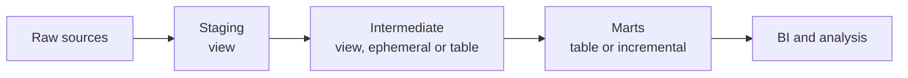
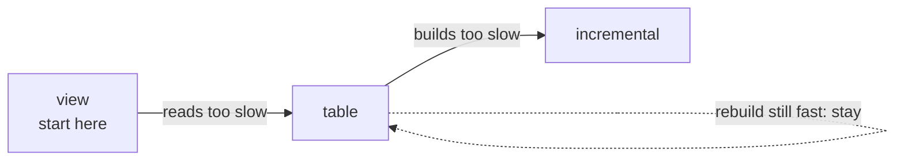
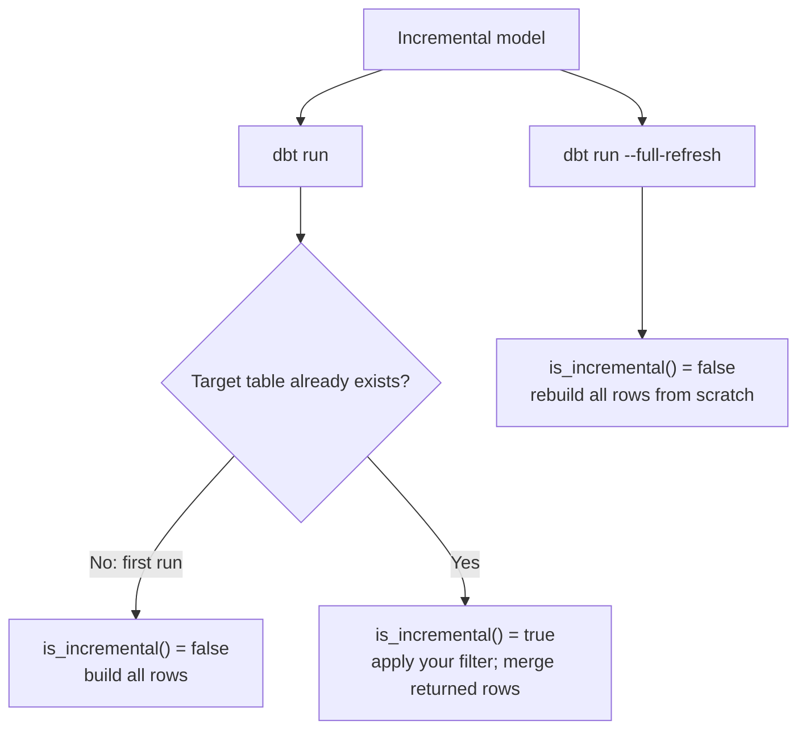
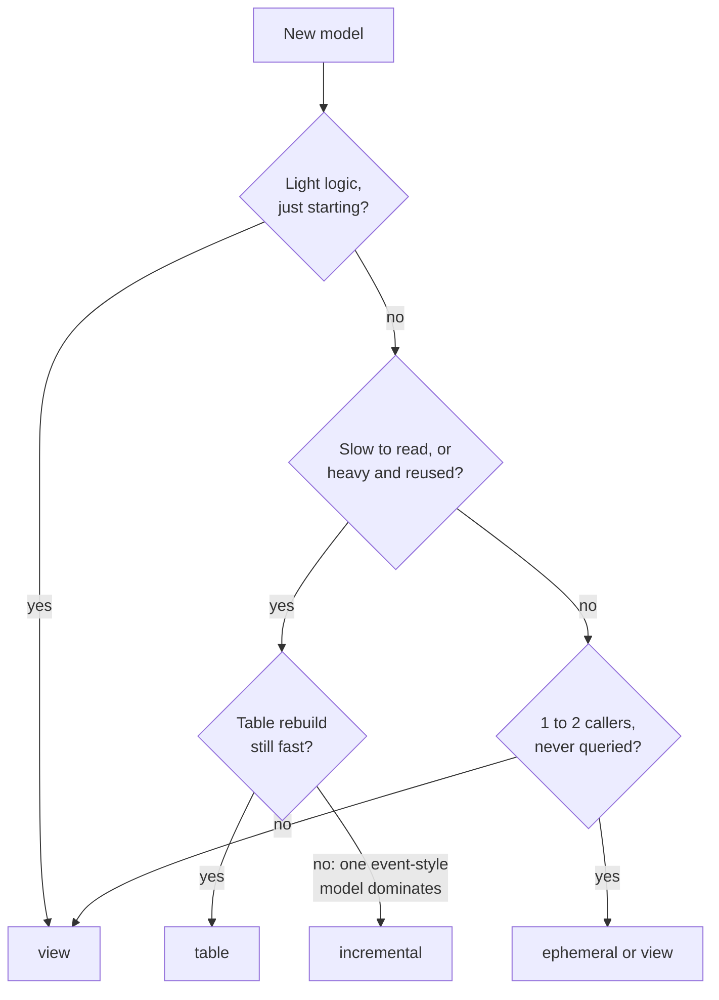

# dbt Materializations: A Reading Guide

For: Rozie · Built on your Notion notes "DBT - Materialization" (Nov 2025) · Checked against docs.getdbt.com, Nov 2026
Length: about 6 A4 pages. Read one page at a time; each page stands on its own.
Companion: "dbt Snapshots and SCD: A Reading Guide" (history of changing rows; snapshots are not a materialization, so they live in their own guide).

## Outline

1. The big picture: what a materialization is, the five types, where to set it
2. View and table: when to start, clues to upgrade
3. Ephemeral: the CTE that never becomes a table
4. Incremental, part 1: `is_incremental()`, `unique_key`, `--full-refresh`, clues
5. Incremental, part 2: strategies, lookback, what "schema" means, `on_schema_change` impact and mitigation, proof
6. Materialized view, the decision guide, fixes to your notes, check-yourself questions

How to read: every page follows the same order. The problem it solves, the mental model, a real example, when to use it, when not to, and the common mistake. Tags used: **Fact** (stated in the official docs), **Hypothesis** (likely, not verified), **Unknown** (could not verify).

---

## Page 1 · The big picture

### The problem

A dbt model is just a `select` statement. Someone has to decide what the warehouse does with that select. Does it store the result? Does it recompute it every time someone asks? Does it only add the new rows? That decision is the **materialization**.

> A materialization decides **where a model's result lives** and **when it gets computed**.

Pick wrong and you get one of three pains: queries that crawl (nothing is stored), runs that take hours (everything is rebuilt), or stale data (stored, but nobody refreshes it).

### The mental model: a restaurant kitchen

- **View** is a recipe card. Nothing is cooked until a customer orders, and every order is cooked fresh. Always fresh, but slow if the recipe is heavy.
- **Table** is the dish cooked in advance. Fast to serve, but it only gets updated when the kitchen cooks again (`dbt run`).
- **Incremental** is topping up the dish with only today's new ingredients, instead of cooking everything from scratch.
- **Ephemeral** is a step written into other recipes. It never exists as its own dish.
- **Materialized view** is a dish the kitchen keeps warm and tops up by itself. You do not cook it; the platform does.

### The five built-in materializations (Fact)

| Type | What dbt does | Stored? | Who refreshes it |
|---|---|---|---|
| `view` | `create view as` | No (only the query is saved) | Computed on every read |
| `table` | `create table as` | Yes | Rebuilt fully on every `dbt run` |
| `incremental` | Insert or update only new/changed rows | Yes | `dbt run`, partially |
| `ephemeral` | Nothing built; SQL is pasted as a CTE | No | Not applicable |
| `materialized_view` | Creates a database materialized view | Yes | The platform |

Your Notion notes cover four of these. The docs list five. `materialized_view` is the one missing from your notes; it gets its own section on page 6.

### Where they sit in the workflow

Your own layer map is the right starting point:



The default moves from "cheap and fresh" at the left to "fast to query" at the right. Staging is light, so views are fine. Marts are what BI tools hit all day, so they get stored.

### How to set it: three places (Fact)

1. `dbt_project.yml`, for a whole folder:
   ```yaml
   models:
     my_project:
       marts:
         +materialized: table
   ```
2. A properties `.yml`, for one model:
   ```yaml
   models:
     - name: fact_order
       config:
         materialized: table
   ```
3. A `config()` block at the top of the model file:
   ```sql
   {{ config(materialized='table') }}
   select ...
   ```

The default when nothing is set is `view`. When the same model is configured in more than one place, the more specific one wins: the `config()` block beats the properties file, which beats `dbt_project.yml`. (Hypothesis: I am recalling this precedence order; confirm it on the dbt "config" reference page before relying on it.)

### The one habit to build

**Start at view. Move up only when a measured clue tells you to.** The ladder from your own notes is exactly right:

1. Start with a view.
2. When it takes too long to **query**, switch to a table.
3. When it takes too long to **build**, switch to incremental.



The next pages explain what "too long" should look like in practice.

---

## Page 2 · View and table

### View

**Problem it solves:** you want a named, reusable piece of logic without paying to store it, and you want it to always reflect the latest source data.

**Model:** a saved query. The warehouse stores the text of the select, not the rows. Every time anyone reads the view, the select runs again.

**Use it when:**
- The logic is light: renaming, recasting, filtering (this is most of staging).
- You need the freshest data and cannot tolerate "last built at 06:00".
- You are starting a model and do not yet know if it is slow.

**Do not use it when:**
- It does heavy joins or aggregations that many people query.
- It is stacked on top of other views. Each layer is recomputed on every read, so the cost multiplies.

**The common mistake:** a chain like `stg → int → fct` where everything is a view. It works fine on 10,000 rows and quietly becomes a 4-minute dashboard at 10 million.

### Table

**Problem it solves:** a heavy query that many people read should be computed once, not once per reader.

**Model:** a photo of the result. dbt rebuilds the whole table with `create table as` on each `dbt run`, then everyone reads the stored rows.

**Use it when:**
- It is a mart that BI tools or analysts hit repeatedly.
- It holds logic that is slow and reused by many downstream models.
- Stable read performance matters more than freshness to the minute.

**Do not use it when:**
- The table is huge and each run rebuilds every row, although only a few rows changed. That is the signal to look at incremental (pages 4 and 5).

**The common mistake:** expecting new source rows to show up in a table without running dbt again. A table is only as fresh as the last `dbt run`.

### Clues for upgrading (view → table)

Move a view to a table when you can point to one of these:

| Clue | What it looks like |
|---|---|
| Slow readers | A dashboard or query on this model is visibly slow |
| Stacked views | Three or more views deep before you reach real tables |
| Heavy logic reused | Many models select from it, each paying for the same joins |
| Repeated reads | It is hit hourly or more, so computing once is cheaper |

If none of these is true, **stay a view**. Staying simple is a valid decision.

### Worked example from your notes

Your notes list real cases from your earlier work. Two of them are worth keeping as rules of thumb:

- `stg_*` models → **view**: light select, must stay fresh, queried by several models.
- `fct_orders` → **table**: large volume, queried by Looker all day, being up to one hour stale is acceptable.

Your `int_paid_orders` note ("under 100K rows → view, over 100K → table") is a reasonable start. Treat the 100K as a **hypothesis to measure**, not a law: the real test is how long it takes to read.

### A decision memo you can write for any model

In one line: *"`<model>` is a `<type>` because `<clue>`; revisit if `<measured thing>` passes `<threshold>`."*
Example: *"`stg_zomato__order` is a view because it is a light rename of the source; revisit if it ever gains joins."*

---

## Page 3 · Ephemeral

### The problem

Early in the DAG you often have small bits of logic that only one or two models need: a cleanup, a dedupe, a pre-aggregation. Making each one a view or table fills your warehouse with objects nobody queries.

### The model: a sticky note pasted into other recipes

An ephemeral model is **never built**. When another model does `ref()` it, dbt pastes the ephemeral model's SQL into that caller as a CTE (a `with` block). Nothing exists in the warehouse.

```sql
-- models/intermediate/int_clean_orders.sql
{{ config(materialized='ephemeral') }}
select order_id, lower(status) as status
from {{ ref('stg_zomato__order') }}
```

When `fact_order` selects from `int_clean_orders`, the compiled SQL begins with something like `with __dbt__cte__int_clean_orders as (...)`. (Fact: dbt prefixes the identifier with `__dbt__cte__`.)

### What the docs say you cannot do (Fact)

- You cannot select directly from an ephemeral model, because there is no object to select from.
- `dbt run-operation` macros cannot `ref()` an ephemeral model.
- Ephemeral models do not support model contracts (this matters in M4).
- Overusing them makes queries harder to debug.

### Use it when
- The logic is light and sits early in the DAG.
- Only one or two models use it.
- Nobody will ever query it directly, and you want no extra warehouse clutter.

### Do not use it when
- You want to look at its output while debugging. There is nothing to look at.
- Many models depend on it. The same CTE is pasted and recomputed in each of them.
- You need a contract or want to test it in isolation in the warehouse.
- The logic is heavy.

### Ephemeral vs view: a practical opinion

Your decision tree in the notes says "used by one model → consider ephemeral". That is a fair default. My opinion (Hypothesis): for intermediate models, a **view is usually easier to live with** than ephemeral, because you can query it while debugging and it still costs almost nothing to store. Use ephemeral when you specifically **want no object in the warehouse**.

### Where to see what ephemeral does

After `dbt compile -s fact_order`, open `target/compiled/…/fact_order.sql` and find the pasted CTE. Seeing it once makes the concept stick. (Unknown: I did not verify this exact compile output on your DuckDB setup; try it and compare.)

### The common mistake

Making a model ephemeral and then trying to `select * from` it in the warehouse to check something. It will say the relation does not exist, because it genuinely does not.

---

## Page 4 · Incremental, part 1: the idea

### The problem

A table rebuilds every row on every run. With 10 million orders, the run is slow and costs real compute, even though yesterday's 9.99 million rows did not change. Your notes capture this well: after about 7 days the share of rows that still change is tiny, so reprocessing them wastes effort.

### The model: update the ledger, do not rewrite it

Instead of copying the whole ledger every night, add or fix only the lines that changed since last time.

> Incremental is about **how the table is built** (cheaper), not about what it keeps. It does not mean "store only the latest value". An `append` incremental model keeps every row.

### How dbt knows what is "new": `is_incremental()` and `{{ this }}`

```sql
{{ config(materialized='incremental', unique_key='order_id') }}

select * from {{ ref('stg_zomato__order') }}


  where updated_at >= (select max(updated_at) from {{ this }})

```

- `{{ this }}` means "the table this model already built". The filter asks: what is the newest row I already have?
- `is_incremental()` is true only when **all** of these hold (Fact): the model already exists in the database, you did not pass `--full-refresh`, and the model is configured as `incremental`.
- The first run has no existing table, so `is_incremental()` is false and dbt builds everything. Later runs apply the filter.



Your notes mention "4 required conditions". The docs I checked list the three above. The fourth is **Unknown** to me; if you find it in the dbt Learn course, add it to your notes.

### What `unique_key` does

Without `unique_key`, dbt only inserts the selected rows. If a row was updated at the source and you re-read it, you get a duplicate (on most adapters). With `unique_key='order_id'`, dbt treats rows with the same key as the same row: replace it if it exists, insert it if it does not. Keys must be unique and non-null.

### `dbt run` vs `dbt run --full-refresh`

| Command | What happens to an incremental model |
|---|---|
| `dbt run` | Applies only the filtered new/changed rows to the existing table |
| `dbt run --full-refresh` | Drops the table and rebuilds it from scratch, ignoring the filter |

For a plain `table` or `view`, `--full-refresh` changes almost nothing, because they are rebuilt anyway. It matters when the logic changes: if you change how `discount` is computed, a normal incremental run only fixes new rows, and old rows keep the old formula until you full-refresh.

### Good and bad candidates (from your notes, with additions)

**Good:** immutable event streams (append-only), or tables with a reliable `updated_at`.

**Poor:**
- Small tables, where the rebuild is already fast.
- Data that changes in unpredictable ways, or has constantly changing columns.
- Transformations that need other rows, like `lag() over (partition by …)`, because the new slice alone does not contain the previous rows.

### Clues for upgrading (table → incremental)

- The model **dominates the run time**. Check `execution_time` per model in `target/run_results.json`.
- The data is event-style, and only recent rows change.
- You have a reliable filter column and a unique key.

No universal cutoff; compare runtime with run frequency and cost:

| Per-model runtime | What to do |
|---|---|
| <1 min | Usually fine |
| Several min | Investigate if frequent or dominating the pipeline |
| >10 min | Investigate build cost and bottlenecks |

Results can be checked on target/run_results.json
 
**Do not upgrade** if the full rebuild is already fast. Incremental adds risk (stale rows, drifted logic) in exchange for speed you may not need.

### The common mistake

Reaching for incremental before the runs are actually slow. It is the right tool for a measured problem, and a source of subtle bugs when used early.

---

## Page 5 · Incremental, part 2: strategies and edge cases

### Strategies: how dbt applies the new rows

The strategy is the SQL dbt uses to combine the new rows with the existing table. It is set with `incremental_strategy`.

| Strategy | What it does | Best for | Watch out |
|---|---|---|---|
| `append` | `insert into` only | Truly immutable event streams | Duplicates if a row is re-read |
| `merge` | Updates matching keys, inserts new keys | Rows that can be updated (a Type 1 pattern) | Can scan the whole target table on big data |
| `delete+insert` | Deletes matching rows, then inserts fresh ones | Platforms without `merge` | Needs a full-table scan to match |
| `insert_overwrite` | Replaces whole partitions | Partitioned tables, mostly BigQuery | More complex; not for DuckDB |
| `microbatch` | Splits time into batches and rebuilds each | Very large time series, easy backfills | Needs a reliable `event_time`; dbt 1.9+ |

### What your DuckDB project supports (Fact, from the dbt-duckdb docs)

`append`, `delete+insert`, `merge`, `microbatch`. Notes:
- `merge` needs **DuckDB 1.4.0 or later** and a `unique_key`. Check your DuckDB version before choosing it.
- `microbatch` needs dbt 1.9 or later (your repo uses 1.10.22).
- Which strategy is the default for dbt-duckdb: **Unknown**. Always set `incremental_strategy` explicitly so you are not guessing.

### Late-arriving data and the lookback window

Some rows reach your warehouse days after they happened, or get corrected after the fact. If your filter is "only rows newer than the newest I have", you will miss them forever.

The fix is a **lookback window**: re-read a recent slice every run and let the `unique_key` replace the rows that already exist.

```sql

  where order_date >= current_date - interval 3 day

```

How to choose the window, in the words of your notes: analyze how late data actually arrives, decide how much incorrectness the business can tolerate, set the cutoff from those two inputs, and run a `--full-refresh` periodically (for example weekly) to get back to the "true" table. The goal is "close enough and performant", not perfect.

The rule of thumb: **never set the lookback shorter than your latest real late data.**

### Microbatch: why and how

**Why:** A single incremental query over a huge time-series table can be slow or hard to retry. Microbatch divides the work into independent time windows, so dbt can rerun a failed window or backfill a date range without rebuilding all history. It is useful when data volume justifies that extra machinery; it is not a faster default for a small model.

**How:** Set `event_time` (the event's time column), `begin` (start of history), and `batch_size` (`hour`, `day`, `month`, or `year`). With `batch_size='day'`, dbt runs a separate query for each day and writes that day's result to the target. You do **not** write an `is_incremental()` filter: dbt filters direct upstream `ref()`/`source()` inputs that also declare `event_time`. Without that upstream config, each batch may scan the whole input.

| Setting | Example | Effect |
|---|---|---|
| `event_time` | `order_timestamp` | Assigns each row to a time window |
| `begin` | `'2024-01-01'` | Starts the initial history build here |
| `batch_size` | `'day'` | Runs one query per day |
| `lookback` | `3` | Reprocesses recent daily batches for late arrivals |

**Example:** If an order from Monday arrives on Wednesday, reprocessing Monday's batch can include it. If it arrives after Monday falls outside the lookback, a normal run misses it; backfill that range with both `--event-time-start` and `--event-time-end`. This is still based on *event time*, not arrival time. A broad `--full-refresh` is not the usual repair tool for microbatch; dbt recommends targeted time-range backfills. For M2's `fact_order`, stick with `merge` so you can first learn and prove the row-level filter. [dbt microbatch docs](https://docs.getdbt.com/docs/build/incremental-microbatch)

### First: what does "schema" mean here?

The word has two meanings, and mixing them up causes most of the confusion.

| Meaning | What it is | Example | Where you see it |
|---|---|---|---|
| **Schema = a folder of tables** | A namespace inside the database that groups tables and views | `staging`, `marts` | `+schema: 'staging'` in `dbt_project.yml` |
| **Schema = the shape of one table** | Its column names and data types | `order_id integer, status varchar` | `on_schema_change` |

`on_schema_change` uses the second meaning. "Schema change" here means: **the columns your model now produces are different from the columns the existing table has.**

### `on_schema_change`: what if columns change?

| Value | Behavior |
|---|---|
| `ignore` (default) | A new column is skipped; a removed column makes the run fail |
| `fail` | Errors when source and target schemas diverge |
| `append_new_columns` | Adds new columns, keeps removed ones |
| `sync_all_columns` | Adds new, removes missing, adjusts types |

None of these **backfills** old rows for a new column. The docs say to populate old values with manual updates or a `--full-refresh`. Old rows will not have the new value until you do (Hypothesis: they will show as null). `on_schema_change` only tracks top-level columns, not nested ones (Fact).

### Impact by materialization: you add a column `delivery_fee` to the model

| Materialization | What happens | Action needed |
|---|---|---|
| view | The view is recreated on the next run, so the column appears | None |
| table | Rebuilt in full, so the column appears for every row | None |
| ephemeral | The CTE is pasted again with the new column | None |
| **incremental** | **Depends on `on_schema_change`** (see below) | **Yes, a decision** |

Only incremental models (and snapshots, in the companion guide) carry old data forward, so only they have this problem.

For an incremental `fact_order`, the same change plays out like this:

| Setting | New column `delivery_fee` | Old rows | If a column is removed |
|---|---|---|---|
| `ignore` (default) | Silently not added. The run succeeds and you do not notice | n/a | Run fails |
| `fail` | Run errors loudly | n/a | Run errors |
| `append_new_columns` | Added to the table | No value | Old column stays |
| `sync_all_columns` | Added | No value | Column removed, types adjusted |

The dangerous one is `ignore`: the default hides the change and your new column never reaches the table.

### Then what, and how to solve (per setting)

| Setting | Then what? | How to solve |
|---|---|---|
| `ignore` (default) | **Add a column:** not added to the table, the run succeeds, BI and downstream models lack the column and you notice late.<br>**Remove a column:** the run fails. | Set `on_schema_change` on purpose, then `dbt run --full-refresh --select model+` so the new column is filled.<br>For a removed column: full-refresh the model. |
| `fail` | Every change makes the run **error** and the pipeline stops. Downstream models do not run. | Decide by hand. If the new column is wanted: full-refresh `model+`, or temporarily switch to `append_new_columns`, then switch back to `fail`. |
| `append_new_columns` | **Add:** column added, old rows empty.<br>**Remove:** the old column stays, new rows are empty in it (dead columns pile up). | Fill old rows with `--full-refresh --select model+` or a manual update. Clean dead columns with a full refresh or a manual drop. |
| `sync_all_columns` | **Add:** added, old rows empty.<br>**Remove:** the column is **dropped together with its data**. Types are adjusted too. | Check who uses a column before removing it from the model. Fill old rows with a full refresh. Keep a backup if the data matters, and use `fail` for critical models. |

"Dead columns pile up" and "old rows empty" are Hypotheses from how tables work. The docs only say old columns are not removed and nothing is backfilled.

**When to use which**
- `ignore`: throwaway or dev models, or columns that truly never change. You accept silent misses.
- `fail`: important marts and anything BI reads. Every column change needs a human decision.
- `append_new_columns`: sources that keep gaining columns. Old rows stay empty for the new column.
- `sync_all_columns`: the table must mirror the model exactly. You accept columns being dropped; on BigQuery, type changes cost a full table scan.

**When it applies:** these settings act on a normal `dbt run`. A `--full-refresh` rebuilds the table from the current model, so there is nothing to reconcile (my reasoning from drop-and-rebuild, not a docs quote).

### Mitigation: a playbook

1. **Choose the setting on purpose.** Do not live on the default for tables people depend on.
   - `fail` for important marts: loud and safe, you decide each change.
   - `append_new_columns` when changes are mostly additive.
   - `sync_all_columns` only when you accept columns being dropped; on BigQuery, type changes need a full table scan.
2. **Backfill old rows.** Either a manual update, or `--full-refresh`. The docs recommend: whenever the logic of your incremental model changes, run a full refresh of the model **and its downstream models**:
   ```
   dbt run --full-refresh --select fact_order+
   ```
   The trailing `+` includes the models downstream of `fact_order`.
3. **Remember the config wins over the flag.** If `full_refresh` is set in the model config, it overrides `--full-refresh` on the command line (Fact).
4. **Catch it before production.** A model contract (M4, parked for now) makes dbt fail when the shape changes without you intending it.

One-line version: *new column in an incremental model = pick `on_schema_change` deliberately, then full-refresh the model and everything downstream if old rows need the value.*

### Proving it works (this is your M2 task)

The senior question is "how do you know the incremental model equals the full one?". The answer is evidence: build the full table, build the incremental version, and compare them with `audit_helper`, plus record the runtimes. That evidence goes in `docs/incremental_proof.md`. (Unknown: whether `audit_helper` works on DuckDB; its docs name no adapters, so test it, and keep a plain `EXCEPT` query as a fallback.)

### A CI note, parked for M3

Your notes end with the CI trick (`dbt clone` so the incremental model runs incrementally in a PR schema). That belongs to M3, not now. Keep the page, do not open the topic yet.

### How the new column fills over time (lookback + `unique_key`)

After you add a column, the table has two parts: old rows that stay empty, and rows processed since the change, which are filled. Rows re-read by the lookback window are replaced as a whole row, so they get the new column on the first run. The boundary between the two parts does not move until you run `--full-refresh`. A dashboard that uses the new column over a long period will look correct but cover only part of the rows (the empty values are a Hypothesis; the docs only say there is no backfill).

### How often to full refresh (Fact: dbt best practices)

- A common pattern for incremental models of manageable size is a full refresh weekly or monthly, at a low-activity time (for example the weekend), to reset drift from late-arriving data.
- A longer lookback window means a less efficient model but slower drift. Drift never reaches zero: with a 3-day lookback, a record that arrives 4 days late is still missed.
- To choose the frequency (Hypothesis, not a standard): measure how late data really arrives, set the business tolerance, set the lookback from those two, then compare incremental vs full refresh with `audit_helper`. If the difference is zero after a week, weekly is too often.
- Very large tables: full refresh may take hours or cost a lot. Refresh rarely, or move to microbatch and backfill by date range.

### `append_new_columns` vs `sync_all_columns`: the real trade-off

| | `append_new_columns` | `sync_all_columns` |
|---|---|---|
| Model run fails? | No | No |
| Column removed from the model | Old column stays (empty for new rows) | Column and its data are dropped |
| Main risk | Dead columns pile up | Accidental data loss |
| When it breaks | Almost never | Downstream models or dashboards that still read the dropped column |
| Manual work | Check and clean dead columns | Almost none |

Rule of thumb: rarely delete columns and many consumers (for example an OBT) → `append_new_columns`. Frequent cleanup and strict review → `sync_all_columns`. Critical table → `fail`.

### Dead columns with `append_new_columns`

- Data in the dropped column stays for old rows and is empty for new rows. Which rows count as "old" at the lookback boundary depends on the strategy: `delete+insert` likely blanks re-read rows; `merge` is Unknown. Test it before relying on it.
- Finding dead columns (all Hypothesis, practical methods):
  1. Build the model in a dev schema and compare its column list with prod (`information_schema.columns`).
  2. `audit_helper.compare_relation_columns` shows columns only in A, only in B, or in both (README fact; DuckDB support is Unknown).
  3. `select max(date_col) from t where the_column is not null` shows when a column stopped being filled.
  4. Compare with the columns listed in `schema.yml`.
- Cleaning: full refresh the model, or `alter table … drop column`. Check downstream readers first, and back up data you may need.
- Prevention: when you remove a column from a model, note it in the PR and schedule a full refresh afterwards.

### M2 experiment idea (small, DuckDB)

Build an incremental model with `append_new_columns`, drop one column from the model, run again, and inspect rows inside and outside the lookback boundary. Write the result in `docs/incremental_proof.md`.

---

## Page 6 · Materialized view, the decision guide, and fixes to your notes

### Materialized view

**Problem it solves:** you want table-like read speed and view-like freshness without writing incremental logic yourself.

**Model:** a table that the database keeps up to date by itself.

The docs describe it as "a combination of a view and a table" that serves use cases similar to incremental models (Fact).

**Where it works and where it does not:**
- It depends on the platform. Some warehouses support it natively.
- On Snowflake, dbt does not use materialized views and uses **Dynamic Tables** instead (Fact).
- It does not refresh everywhere. For example, Postgres materialized views do not refresh automatically (check your adapter's page in the dbt docs before relying on this).
- DuckDB support for `materialized_view`: **Unknown**. The dbt-duckdb docs I checked do not mention it.

**Config you may meet:** `on_configuration_change`, which controls what dbt does when you change the view's config (apply, continue, or fail).

**Use it when:** the platform supports it, a simple incremental-style need is enough, and you are happy to let the platform own the refresh.
**Do not use it when:** the adapter does not support it, or you need logic that the platform's refresh cannot express.
**The common mistake:** assuming it refreshes itself on every platform.

### Not a materialization: snapshots

Snapshots produce a table, but they are their own resource type with their own command (`dbt snapshot`) and folder (`snapshots/`). The `materialized=` config does not apply. The full story (SCD Type 1 vs Type 2, strategies, edge cases) is in the companion guide "dbt Snapshots and SCD". Your folder mapping note "`staging/`: view (or table for snapshots)" mixes the two ideas; keep them apart.

### The decision guide

| Situation | Choose |
|---|---|
| Light rename/recast, just starting | view |
| 1–2 callers, never queried directly, light logic | ephemeral (or a view) |
| BI is slow, views are stacked, or heavy logic is reused | table |
| Table rebuild is still fast enough | stay a table |
| One event-style model dominates run time | incremental |
| The platform can refresh it for you | materialized view |



Materialized view is a platform-dependent side branch: consider it only when your adapter supports it and the platform can own the refresh.

**Start at view. Move up only when a measured clue says so.**

### Applied to your repo (Hypothesis, based on your notes)

- `stg_zomato__order` → view.
- `int_order_financials` → view (or ephemeral if only one model uses it).
- `fact_order` → table today; incremental is the M2 change, and only because the point of M2 is to prove you can do it safely.

### Fixes to your Notion notes

Small things worth correcting so they do not follow you into an interview:

1. In the model-level example, the key is `materialized`, not `materialization`.
2. In the incremental SQL, Jinja blocks use `` and ``, not `{{ if … }}`. Also check for curly quotes (‘ ’) in the code; use plain `'`.
3. The `dbt_project.yml` example sets `staging` to `table`, but your own folder mapping says `staging` should be `view`. Pick one.
4. Add `materialized_view` to the list of types (docs list five).
5. "Requires 4 conditions" for incremental: the docs list three; find the fourth or correct the note.
6. Make `insert_overwrite` BigQuery-specific in your head; it is not available in your DuckDB setup.
7. Snapshots are not a materialization (see above).

### Check yourself (answer in your own words, no docs)

1. A model is slow to build but fast to query. Which move do you consider, and what do you measure first?
2. You change the `discount` formula in an incremental `fact_order`. You run plain `dbt run`. What happens to the old rows?
3. Why can you not `select *` from an ephemeral model in the warehouse?
4. What does `is_incremental()` return on the very first run, and why?
5. When would you pick `delete+insert` over `merge` on your DuckDB setup?

Questions 1 to 3 will tell us whether the mental model is stable before M2 build starts.

---

### Sources

- [dbt docs: Materializations](https://docs.getdbt.com/docs/build/materializations)
- [dbt docs: About incremental strategy](https://docs.getdbt.com/docs/build/incremental-strategy)
- [dbt docs: DuckDB configurations](https://docs.getdbt.com/reference/resource-configs/duckdb-configs)
- Your Notion notes: DBT - Materialization (Nov 2025)
- Items marked Hypothesis or Unknown were not verified; check them before relying on them.

### Personal learning Notes/ interesting point
1. dbt run --full-refresh itu sahabatannya sama is_incremental()
    1. karna ketika kita bikin dbt run - dengan materialized = 'table', it means that we will rebuild the entire table anw. The benefit of incremental model would not be utilized once we use the table or build the table since the begining
2. ephemeral vs view -> main difference is on would we show the model to the data warehouse or not.
3. `on_schema_change`: reflection from my time at Bolt (Hypothesis, from memory)
    1. I recall the team used `append_new_columns` or `sync_all_columns`. Leaning `append_new_columns` (about 60:40, unverified). I did not note the exact config
    2. Clues for the lean: we rarely deleted columns, and unused columns were left in place (the model was an OBT with many consumers). The difference between the two settings only shows when a column is removed or its type changes, so these clues are weak evidence
    3. I recall it was not `ignore` or `fail`
    4. AE said running the full refresh later is fine, and I agreed. This matches the pattern: add the new column first, backfill old rows later with `--full-refresh`
    5. Caveat: "safe" depends on table size; a full refresh of a large fact table can be slow and costly
    6. Questions that would settle it if I remember: did a renamed column leave the old column behind (append) or remove it (sync)? Did a column type change apply without a full refresh (sync)?
