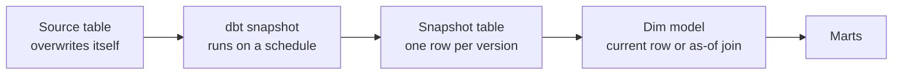
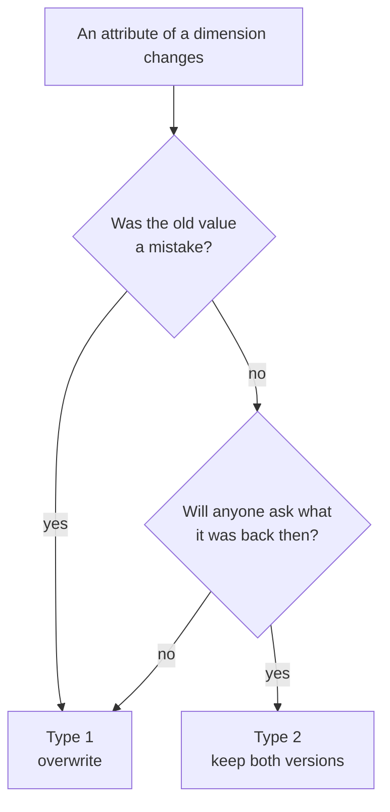
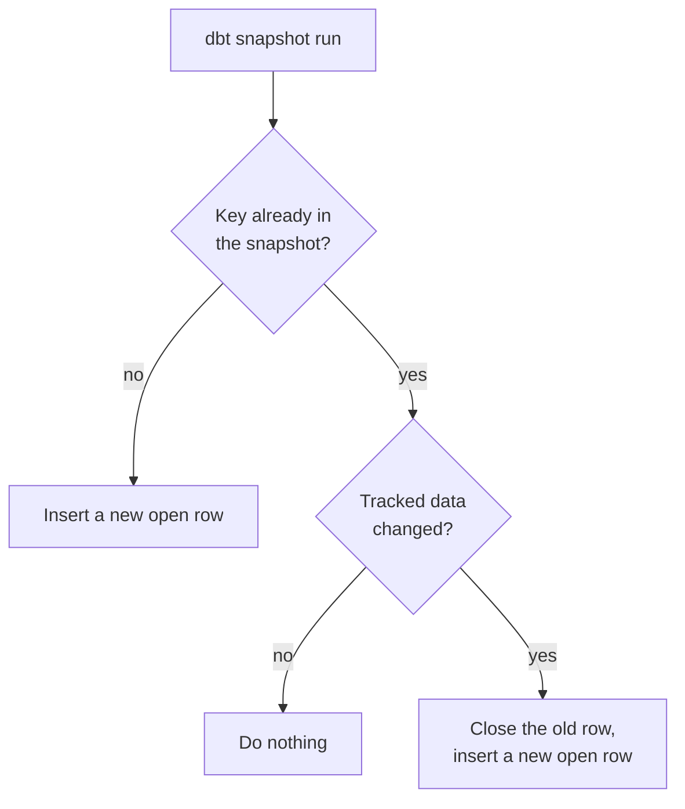
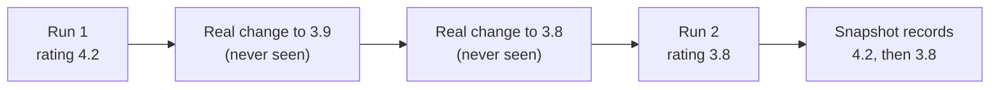

# dbt Snapshots and SCD: A Reading Guide

For: Rozie · Companion to "dbt Materializations: A Reading Guide" · Checked against docs.getdbt.com, Nov 2026
Length: about 6 A4 pages. Read one section at a time.

How to read: every section follows the same order. The problem it solves, the mental model, a real example, when to use it, when not to, and the common mistake. Tags used: **Fact** (stated in the official docs), **Hypothesis** (likely, not verified), **Unknown** (could not verify).

## Outline

1. The big picture: why history, and how this differs from materializations, incremental and backups
2. SCD: what it is, Type 1 vs Type 2, and why both exist
3. How a dbt snapshot works: the mechanics and the meta columns
4. Choosing a strategy: `timestamp` vs `check`
5. Edge cases: what a snapshot cannot do, including what happens when source columns change
6. Reading the history, your M2 build, and check-yourself questions

---

## 1 · The big picture

### The problem

Most source tables keep only the **current** state. Restaurant #7 had a 4.2 rating on 1 November, the source changed it to 3.8 on 8 November, and now the source only knows 3.8. The question "what was the rating when order #500 was placed?" cannot be answered any more, unless someone saved the old value.

### The mental model: a CCTV that records only when something changes

- A normal table is a **photo** of now.
- A snapshot is a **CCTV** that stores a frame only when a row changed.
- The CCTV only looks when you run `dbt snapshot`. Anything that changes and changes back between two looks is invisible.

### Where it sits in the workflow



It lives at the boundary between "raw source that overwrites itself" and "models that need to know the past".

### How it differs from what you already know

| Thing | Question it answers | What it keeps |
|---|---|---|
| Table | "Give me this logic, rebuilt" | Latest result only |
| Incremental | "How do I build this cheaper?" | Whatever its strategy keeps (it is about cost, not history) |
| Snapshot | "What did this row look like before?" | Every version, as seen at run time |
| Backup / time travel / clone | "Can I restore this after a mistake?" | A copy of the whole object for recovery |

Two corrections that come up often:
- **Snapshot is not a materialization.** It produces a table, but it is its own resource type with its own command (`dbt snapshot`) and its own folder (`snapshots/`). The `materialized=` config does not apply. See the materializations guide for the five real ones.
- **Snapshot is not a backup.** A backup is for restoring after damage. A snapshot is for answering analytical questions about the past. Ironically, a snapshot table cannot be rebuilt from the source (section 5), so it is the thing that needs a backup.

### The common mistake

Thinking "incremental keeps the latest value, snapshot keeps everything". Incremental is about build cost. And snapshot keeps everything **it saw**, not everything that happened.

---

## 2 · SCD: Type 1 vs Type 2, and why both exist

### The problem

A dimension, such as restaurant, customer, or product, has attributes that change slowly: city, rating, price tier, segment. When one changes, you must decide: overwrite the old value, or keep it? "SCD" (Slowly Changing Dimension) is the name for the family of answers.

### The types (the numbers are just labels from Kimball's data warehouse books)

| Type | What happens on change | History | Use it when |
|---|---|---|---|
| 0 | Never changes | Original only | Birth date, original sign-up channel |
| **1** | Overwrite the old value | Lost | The old value was wrong, or nobody needs the past |
| **2** | Close the old row, open a new row | Complete | Analysis needs "as of then" |
| 3 | Add a column holding the previous value | One step back | Rare; a simple "before and after" |

Only **Type 1 and Type 2** matter for you now. Know that 0 and 3 exist and move on.

### Why both exist: a concrete story

A restaurant moves from Jakarta to Bandung.

- With **Type 1**, the city column becomes Bandung. Every historical order now appears to belong to a Bandung restaurant. Last month's Jakarta revenue report changes silently after the move, and nobody notices.
- With **Type 2**, the old row (Jakarta) is closed with an end date, and a new row (Bandung) is opened. Old orders still join to Jakarta; new orders join to Bandung. History is preserved.

Neither is "better". Type 1 is simpler, smaller, and always current. Type 2 is bigger and joins are harder, but it answers questions Type 1 cannot. The right one depends on whether the business ever asks "as of then".

### A practical rule

- If the only question is "what is it **now**" → Type 1.
- If any question is "what was it **then**" → Type 2.
- If the old value was a mistake (a typo fix) → Type 1, even in a Type 2 table; the old value is not worth archiving.



### How this maps to dbt

- A `merge` / upsert incremental model gives a **Type 1** result (new values replace old ones by key). Your Notion notes already say this about `merge`.
- `dbt snapshot` produces **Type 2**. Your `dim_restaurant_scd2` model sits on top of it.
- SCD2 is the **pattern**. A snapshot is dbt's **tool** for it. The dim model is how you **serve** it.

### Why this keeps getting asked

"Explain SCD Type 2 and how you would build it in dbt" is a classic analytics engineering interview question, and your repos currently have an empty `snapshots/` folder. That is why it is in M2.

### The common mistake

Using Type 2 for everything "just in case". Each tracked column multiplies versions, and every consumer has to remember to pick the right version.

---

## 3 · How a dbt snapshot works

### The mental model

Each time you run `dbt snapshot`, dbt compares the source (the "relation") to the snapshot table, row by row, using the `unique_key`:

- A key it has never seen → insert a new row, open-ended.
- A known key whose tracked data changed → close the old row (set its end timestamp) and insert a new row.
- A known key with nothing changed → do nothing.

The result is **one table** that only grows by changes, not one copy per run.



### The config (dbt 1.9 and later, YAML in the `snapshots/` directory) (Fact)

```yaml
snapshots:
  - name: snap_restaurant
    relation: ref('stg_restaurant')
    config:
      strategy: timestamp
      unique_key: id
      updated_at: updated_at
```

`relation` can be `source(...)` or `ref(...)`. The names `snap_restaurant`, `stg_restaurant` and the columns here are illustrative; use your real ones.

### The columns dbt adds (Fact)

| Column | Meaning |
|---|---|
| `dbt_valid_from` | When this version became valid |
| `dbt_valid_to` | When it was replaced. `NULL` for the current version (by default) |
| `dbt_scd_id` | A unique key per version row |
| `dbt_updated_at` | The source's change timestamp when this version was inserted |
| `dbt_is_deleted` | `True`/`False`; added when `hard_deletes` is `new_record` |

### A worked example

Source on 1 Nov: restaurant 7, rating 4.2. You run `dbt snapshot`.
Source on 8 Nov: rating 3.8. You run `dbt snapshot` again.

| id | rating | dbt_valid_from | dbt_valid_to |
|---|---|---|---|
| 7 | 4.2 | 1 Nov | 8 Nov |
| 7 | 3.8 | 8 Nov | NULL |

Dates are illustrative. The row with `NULL` in `dbt_valid_to` is the current one.

### Running it

```
dbt snapshot                       # all snapshots
dbt snapshot -s snap_restaurant    # one snapshot
```

Snapshots are meant to run on a schedule, **between hourly and daily** (Fact). The docs are explicit that if you do not run it on a schedule, changes are not recorded.

### The common mistake

Running it once, forgetting the schedule, and then wondering why the history has gaps.

---

## 4 · Choosing a strategy: `timestamp` vs `check`

The strategy decides **how dbt notices that a row changed**.

### `timestamp` (recommended by the docs) (Fact)

- Needs `updated_at`, a column the source maintains.
- Rule: if the row's `updated_at` is more recent than the last snapshot run, the old version is closed and a new one is recorded.
- Why recommended: it tracks one column and is less error-prone when the table's schema evolves.
- **Use it when** the source has a trustworthy `updated_at`.
- **Do not use it when** `updated_at` is missing, only some updates touch it, or it is bumped for irrelevant reasons.

### `check`

- Needs `check_cols`: a list of columns to compare, or `all`.
- Rule: if any listed column changed, the old version is closed and a new one is recorded.
- **Use it when** there is no reliable `updated_at`.
- **Do not use it with `all` on wide tables.** List the columns you care about.
- Tied to the timing: without an `updated_at` set, `dbt_valid_from` is the time of the run, not the time the change actually happened at the source. So the history is only as precise as your run frequency.

```yaml
config:
  strategy: check
  unique_key: id
  check_cols: [name, rating]
```

### The decision

| Situation | Choose |
|---|---|
| Source has a reliable `updated_at` | `timestamp` |
| No `updated_at` | `check` with an explicit list |
| `updated_at` exists but is unreliable | Treat as no `updated_at`: `check` |

### For your `restaurant` seed (Hypothesis)

A seed is a static CSV, so it probably has no maintained `updated_at`. That points to `check` on `[name, rating, …]`. **Unknown** until you open the seed and look. Do not decide before checking the actual columns.

### The common mistake

Using `check` with `all` "to be safe". Adding a column later then changes which rows look changed. Also, if you pick `check_cols` and later add a column that matters, changes in it go unseen until you update the list.

---

## 5 · Edge cases: what a snapshot cannot do

### 1. It cannot see changes between runs

Rating goes 4.2 → 3.9 → 3.8 between two `dbt snapshot` runs. The snapshot sees 4.2 then 3.8, so it records **one** new version, not two. The 3.9 is invisible. This is the CCTV limit. If you need every change, you need change data capture on the source side, not a snapshot. Run it more often if the precision matters.



### 2. It has no history before its first run

History begins when snapshots begin running. Earlier source changes are gone. The docs say the first run creates the initial snapshot table; changes before that were never captured. (The "history starts at the first run" wording is my reading of the docs, not a direct quote.)

### 3. It cannot be rebuilt (Fact)

Snapshots **ignore** `--full-refresh` and the `full_refresh` config. The docs say snapshots cannot be rebuilt. If the table is dropped, the history goes with it. Treat the snapshot table like precious data: put it in its own schema, protect it, back it up.

### 4. Deleted rows

By default (`hard_deletes: ignore`) a row deleted at the source simply stops updating; the snapshot still shows it as current forever. Options (Fact):

| Value | Behavior |
|---|---|
| `ignore` (default) | Nothing happens to deleted rows |
| `invalidate` | Sets `dbt_valid_to` on the deleted row |
| `new_record` | Adds a row with `dbt_is_deleted = True` |

### 5. Making "current" easier to filter

By default the open row has `dbt_valid_to = NULL`. You can set `dbt_valid_to_current` to a future date such as `9999-12-31`, so date-range joins need no `or … is null`. If you set it, filter on that date, not on `NULL`.

### 6. The key must really be unique

`unique_key` must identify one row in the source at a time. If the source has duplicates for a key, versions get tangled.

### 7. Adapter support

Whether your adapter (dbt-duckdb) fully supports snapshots: **Unknown**. The dbt-duckdb configuration page does not mention snapshots. You will find out in the first run; if it errors, paste the error before spending more than 20 minutes.

### 8. The source adds, removes or retypes a column

Snapshots have no `on_schema_change` setting. dbt reconciles on its own (Fact, from the dbt FAQ "What happens if I add new columns to my snapshot query?"):

| Source change | What dbt does to the snapshot table |
|---|---|
| New column | Creates the column in the snapshot table. Old versions have no value for it |
| Column removed | **Does not delete** the column from the snapshot table |
| Type changed | Does not change the type, except it may widen `varchar` sizes. A `string` that becomes a `date` is not converted |

Two practical consequences:
- With `strategy: check`, a new column that matters is **not tracked** until you add it to `check_cols`. This is why `timestamp` is called less error-prone when the schema evolves.
- Because the snapshot table cannot be rebuilt, a bad type change cannot be fixed with `--full-refresh`. It needs a manual fix. Treat source type changes as something to catch early.

### The common mistake

Treating the snapshot table as disposable, like a model. Models can be rebuilt; this one cannot.

---

## 6 · Reading the history, your M2 build, and check-yourself questions

### Two ways to read a snapshot

A snapshot answers two different questions. They need different queries.

**A. What is true now → the current row**

```sql
select *
from {{ ref('snap_restaurant') }}
where dbt_valid_to is null
```

(If you set `dbt_valid_to_current`, filter on that date instead.)

Use it for dashboards on the current state and joins to today's facts.

**B. What was true then → the as-of join**

```sql
from fact_order o
join snap_restaurant r
  on  o.restaurant_id = r.id
  and o.order_date >= r.dbt_valid_from
  and (o.order_date < r.dbt_valid_to or r.dbt_valid_to is null)
```

Each order joins to the restaurant version that was valid when the order happened.

**Danger:** if you join facts to the snapshot **without** a time condition, every old version joins in and your fact rows multiply. This is the most common way a Type 2 table quietly doubles revenue.

A snapshot is referenced from a model with `ref()`, like any model (Fact).

### Your M2 build (from the curriculum)

1. Write `snapshots/snap_restaurant.yml` with the right strategy (decide after looking at the seed).
2. Run `dbt snapshot`. Change one value in the source. Run again. Confirm you see two versions with the right `dbt_valid_from` and `dbt_valid_to`.
3. Build `dim_restaurant_scd2` as a model over the snapshot.
4. Write the current-row query and the as-of join, and check that the as-of join does not change the row count of `fact_order`.

Suggested test ideas (Hypothesis, to evaluate with your testing strategy): `dbt_scd_id` is unique; for one `id`, versions do not overlap in time; an as-of join returns exactly one version per order.

### How this connects to the materializations guide

| Materializations guide | This guide |
|---|---|
| `merge` upsert gives a Type 1 outcome | Snapshot gives Type 2 |
| `--full-refresh` rebuilds an incremental model | Snapshots ignore `--full-refresh` |
| Incremental risk: late data is missed | Snapshot risk: changes between runs are missed |
| "Start at view, move up on a measured clue" | "Start with Type 1, move to Type 2 only when someone asks 'as of then'" |

### Check yourself (answer in your own words, no docs)

1. Rating changes 4.2 → 3.9 → 3.8 between two `dbt snapshot` runs. How many versions are recorded, and why?
2. For a restaurant, which is Type 1 and which Type 2, and why: rating, city, a typo fix in the name?
3. Why can you not rebuild a snapshot with `--full-refresh`? What does that mean for where you store it?
4. You join `fact_order` to the snapshot on `restaurant_id` only. What goes wrong?
5. The source has no `updated_at`. Which strategy, and how precise is `dbt_valid_from` then?

---

### Sources

- [dbt docs: Snapshots](https://docs.getdbt.com/docs/build/snapshots)
- [dbt docs: DuckDB configurations](https://docs.getdbt.com/reference/resource-configs/duckdb-configs) (no mention of snapshots)
- SCD type numbering: Kimball's dimensional modeling convention (general knowledge, not re-verified)
- Items marked Hypothesis or Unknown were not verified; check them before relying on them.
