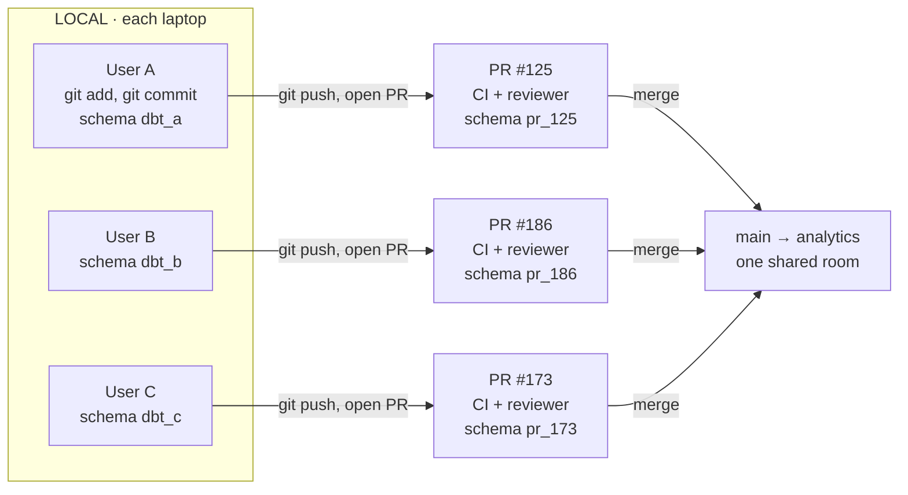
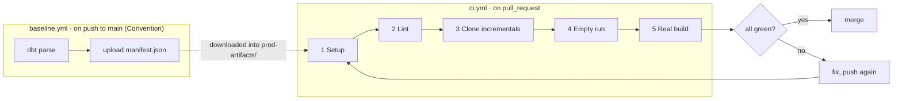
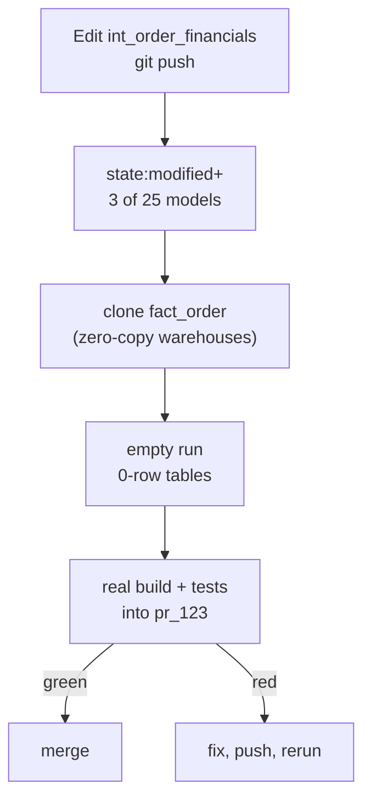
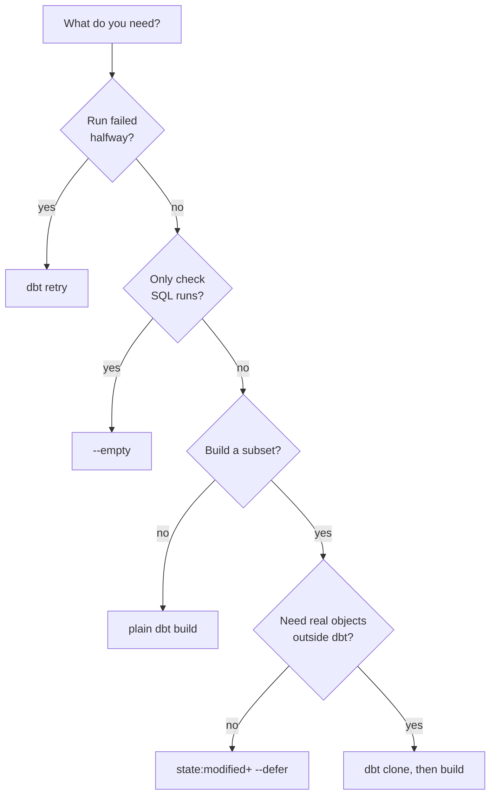

# dbt CI/CD with GitHub Actions: A Reading Guide

For: Rozie · Built on the M3 pre-read (21 Nov 2026) · Checked against dbt, GitHub and Git docs, Nov 2026
Length: about 6 A4 pages. Read one page at a time; each page stands on its own.
Companion: `dbt-state-defer-clone-reading.md` (state, defer, clone, retry and `--empty` are explained there and used here). Pictures: the "dbt CI/CD and State A3" canvas. Each page below says which picture it matches.

**Learning outcome:** after this guide you can explain, in your own words and without the docs, where a change travels from your laptop to production, which schema it writes at each stop, and where CI sits and why. You can name the five stages of a slim CI run, say what each one proves and what it cannot, and pick the cheapest dbt tool for a situation. You can list what has to exist before a `ci.yml` can run. Check: answer the 5 questions on page 5.

## My notes (read this first)

*Your own notes go here, in your own words. This section is yours; nothing in the guide below rewrites it.*

---

## Outline

0. The map: three rooms, the git steps, and where CI sits (picture: Page 0)
1. The CI pipeline: five stages on every pull request (picture: Page 1)
2. One pull request, step by step (picture: Page 2)
3. Which tool do I reach for? (picture: Page 3)
4. Setup: what must exist before CI can run (read after page 1 is clear)
5. Corrections, check-yourself questions, sources

How to read: every page follows the same order. The problem it solves, the mental model, a real example, when to use it, when not to, and the common mistake. Tags used: **Fact** (stated in the official docs), **Hypothesis** (likely, not verified), **Unknown** (could not verify), **Convention** (a team choice, not a dbt or GitHub rule).

Versions: your local dbt is 1.10.22 with dbt-duckdb; the cert is written for dbt Core 1.11. Some docs pages describe the dbt platform, not Core. The text says so where it matters.

---

## Page 0 · The map: three rooms and where CI sits

*Picture: Page 0 (swimlane with users A, B, C).*

### The problem

Three people (A, B and C) change the same dbt project at the same time. Production is shared, and real people read it. Nobody can see another laptop, so "it ran on my laptop" proves very little.

### The mental model: three rooms

> Git moves **code**. dbt writes **data**. A change walks through three rooms. The PR is the room; CI and the reviewer are its security.

| Room | Code lives | Data lives (schema) | Written by | Why the room exists |
|---|---|---|---|---|
| **LOCAL** | your laptop | `dbt_a` (dev) | your own `dbt build` | A private, cheap place to try |
| **PR** | your branch on GitHub, one per PR | `pr_<n>` | the CI job only | A clean, automatic check before `main` |
| **PRODUCTION** | the `main` branch | `analytics` | the prod job only | The only room real users read |

The schema names are examples. In Core you choose them yourself (Convention).

A PR number is just GitHub's counter. `PR #125` is not "user A"; a second change from A would be a new PR.

### Where git acts

| Step | Command | Room | What it does |
|---|---|---|---|
| 1 | `git add` | LOCAL | Moves the current content of a file into the staging area, so that version goes into the next commit. A later edit needs another `git add` (Fact: Git book). |
| 2 | `git commit` | LOCAL | Saves a snapshot of the staging area as a new entry in your local history (Fact: Git book). |
| 3 | `git push` | LOCAL → PR | Updates a branch on the remote so it points at your local commits, and sends the commit data the remote lacks (Fact: git-push docs). This is where code leaves your laptop. |
| 4 | open the PR | PR | Asks to merge your branch into `main`. CI starts here. |
| 5 | merge | PR → PRODUCTION | A reviewer approves and the code lands on `main`. The prod job builds `main` into `analytics`; when it runs depends on your setup (Unknown for your repo). |

- Neither `git add` nor `git commit` contacts a remote (Fact: Git book).
- By default a `pull_request` workflow runs for the `opened`, `synchronize` and `reopened` activity types (Fact: GitHub docs). Hypothesis: `synchronize` means new commits reached the PR branch. So CI runs when the PR opens and again on each later push to it.
- Git never writes to the warehouse. Only dbt does: your `dbt build` writes `dbt_a`, the CI job writes `pr_<n>`, the prod job writes `analytics`.
- Why "pull" request: a request for the owner of `main` to pull your change in. It is the same movement as a push, seen from the other side (background, not verified in the docs).

> Parked, read only if you want: on your laptop git keeps three places, the working tree (files you edit), the staging area (also called the index) and the Git directory (the stored history). `git add` moves a version from the first to the second, `git commit` from the second to the third (Fact: Git book, "What is Git?").

### The PR is the room; CI and the reviewer are its security

- The **PR** is where a proposed change is shown, discussed and checked.
- **CI** is the automatic checking: the same steps on every PR, on a clean machine.
- The **reviewer** is a person who reads the diff and the CI result. CI proves it runs; a person judges whether it is the right model.
- The lock is a GitHub setting. With required status checks, changes can't merge into a protected branch until the required checks pass, and a failing check blocks the merge even for people with push access (Fact: GitHub docs). Without that setting, a red check is advice, not a gate.

### Why not straight from local to production?

| Problem | Why it happens |
|---|---|
| Your laptop is not a neutral place | A build can pass because of an uncommitted file, a stale dev table or local config |
| Production is shared | A mistake there is seen by dashboards and people, not only by you |
| Nobody else can see it | No review, no record of who changed what |
| Three people at once | A, B and C overwrite each other without knowing |
| Fixing prod is expensive | Wrong data that people already read is hard to take back |

"Sterile" means two things: a **clean machine** (CI starts from the code in the PR, not from your laptop) and a **separate schema** (`pr_125` is not production and not someone else's). Whether to have this gate at all is a team choice (Convention): a small team making easy-to-undo changes sometimes goes without.

### When one PR merges

If PR #186 merges first, `main` moves. PRs #125 and #173 still compare against a baseline from the older `main`, so their `state:modified+` selection can include changes that are not theirs. The dbt platform docs warn about this. Fix: rebase on `main`, then refresh the baseline (see the state guide, page 2).

### Use it when
- More than one person changes the project, or production has real readers.
- You want the same checks to run every time, whoever opens the PR.

### Do not use it when
- You are alone on a throwaway project and everything is easy to undo.

### The common mistake

Treating the PR and CI as the same thing, or thinking a PR goes straight into production. A PR goes into `main` (code). Production (data) is what the prod job builds from `main`.

---

## Page 1 · The CI pipeline: five stages

*Picture: Page 1 (baseline lane and five stage cards).*

### The problem

Without CI, "correct" means "ran on my laptop". Each PR either rebuilds everything or ships unchecked.

### The mental model

Slim CI is a clean test room that builds only what your PR changed and borrows the rest from production. State picks the nodes, defer borrows the parents, clone copies the slow incrementals, `--empty` rehearses, and the real build is the exam.

### The baseline lane (Convention)

A separate workflow runs on every merge to `main`, parses the project and stores `manifest.json`. The PR job downloads it into `prod-artifacts/`.

- To download an artifact from a different workflow run, `download-artifact` needs a token with read access to Actions data, the repository and the run ID. A plain download only reaches the current run (Fact: GitHub's download-artifact README).
- The dbt docs do not say how to obtain production artifacts in Core (Unknown). The options are yours to choose; see page 4.

### The five stages

**1 · Setup** (reads only)
- *Why:* a fresh runner has none of your files, tools or credentials.
- *Mental model:* move into a clean room and bring the code, the tools and the photo of `main`.
- *What:* the PR starts a fresh runner, checks out the PR, installs dbt, runs `dbt deps` and downloads the baseline manifest. GitHub-hosted runners are new virtual machines (Fact: GitHub docs).
- *Command:* `on: pull_request`, `dbt deps`, `actions/download-artifact`.
- *Fails when:* the baseline manifest is missing. dbt stops with `no comparison manifest`.
- *Credentials:* repository secrets are read through the `secrets` context and mapped into a step's `with` or `env` (Fact: GitHub docs). They never live in the repo.

**2 · Lint** (no warehouse)
- *Why:* the cheapest check, and it fails fast.
- *Mental model:* a spell-check before the exam.
- *What:* SQLFluff checks formatting and rules. In CI use the dbt templater: slower, but it renders `ref()` and macros the way dbt does (SQLFluff docs). It needs the dbt adapter and the `sqlfluff-templater-dbt` package installed, and `templater = dbt` in `.sqlfluff`.
- *Command:* `sqlfluff lint models/`.
- *Fails when:* a rule is broken. Caveat (checked earlier in M3 research): compile errors are skipped by default, so a lint pass is not a compile pass.

**3 · Clone incrementals** (dbt 1.6+)
- *Why:* in an empty PR schema an incremental model has no table, so `is_incremental()` is false and the whole table rebuilds.
- *Mental model:* photocopy only the big, slow-to-rebuild tables your PR touches.
- *What:* copies existing production incremental tables into the PR schema, so the real build runs incrementally.
- *Command:* `dbt clone -s state:modified+,config.materialized:incremental,state:old --state prod-artifacts`.
- *Fails when:* `state:old` is left out and a new incremental model has no production table. On a warehouse without zero-copy cloning you get pointer views instead of copies (Fact: dbt docs).
- *State after:* `pr_123.fact_order`, a copy of the production table. Clone skips relations that already exist (Fact), so it runs before `--empty`. The docs make clone the first step of a CI job (Fact); the full ordering reason is a Hypothesis.

**4 · Empty run** (dbt 1.8+)
- *Why:* it finds a broken ref, column or join before you pay to read data.
- *Mental model:* a dress rehearsal on an empty stage.
- *What:* runs every changed model on zero-row inputs and creates empty tables.
- *Command:* `dbt build -s state:modified+ --defer --empty --state prod-artifacts`.
- *Fails when:* SQL, a ref or a column is broken. It cannot see wrong numbers (Hypothesis: data tests pass on empty tables).
- *Unknown:* `--empty` together with `--defer` is not in the docs, and the `--empty` page does not mention CI. Test it once.

**5 · Real build**
- *Why:* only this stage tests logic on real rows.
- *Mental model:* the real exam, on a small set of questions.
- *What:* builds only the changed models and what is downstream, then runs their tests. Unchanged parents are read from production through defer.
- *Command:* `dbt build -s state:modified+ --defer --state prod-artifacts`.
- *Fails when:* a test fails. The PR check goes red; push a fix and the same run goes green. That red-then-green PR is the M3 proof.

### What the result means

| Result | What it means | What to do |
|---|---|---|
| FAIL · lint | A style or Jinja rule is broken in a changed file | Fix the file and push. Nothing touched the warehouse |
| FAIL · empty | A ref, column or join does not resolve | Read the error, fix the model, push |
| FAIL · build | A test failed on a changed model or one downstream | Open the failing test, fix logic or data, push |
| FAIL · manifest | The baseline never downloaded, so `state:` cannot compare | Check the download step and that the main workflow ran |
| PASS | All tests passed (warn-severity tests only warn) | Merge. The baseline workflow then refreshes the manifest |

`dbt retry` resumes a failed build from the failure point. A fresh CI runner has no `run_results.json` from an earlier run, so use retry locally (Hypothesis).

### Use it when
- A project big enough that rebuilding everything per PR is slow or costly.
- Every PR, plus merge jobs.

### Do not use it when
- On a scheduled job. `state:modified` on a scheduled job can finish successfully with zero models built when nothing changed since the last deferred run (Fact: dbt deploy-jobs docs).
- The project is tiny and a full build takes seconds.

### The common mistake

Reading a green `--empty` stage as a correct build, or pointing `--state` at `target/`, which dbt overwrites. Avoid it: copy the baseline into its own folder.

---

## Page 2 · One pull request, step by step

*Picture: Page 2 (before, you do, after). The names and numbers are illustrative: PR #123 here, PR #125 on Page 0.*

### The problem

Each tool only makes sense once you see what it saves. So follow one PR: state before, command, state after.

### The model: one change, five steps

### The example

Setup: main is live in `analytics`. The baseline manifest from the last merge is in `prod-artifacts/`. You edit `int_order_financials` (a discount cap).

| Step | Before | You do | After |
|---|---|---|---|
| 1 Edit and push | 25 models; `analytics.fact_order` has 10,000,000 rows (illustrative) | `git push`; `ci.yml` starts on `pull_request` | The project differs from the baseline in exactly one file. Nothing in the warehouse changed |
| 2 Select | dbt remembers only the baseline photo | `dbt ls -s state:modified+ --state prod-artifacts` | 3 of 25 selected: `int_order_financials`, `fact_order`, `mart_order_city_currency_day_utc`. `stg_*` are not |
| 3 Clone | `pr_123` is empty; `fact_order` is incremental | `dbt clone -s state:modified+,config.materialized:incremental,state:old --state prod-artifacts` | `pr_123.fact_order` is a copy of the prod table, or a pointer view without zero-copy |
| 4 Empty run | `pr_123` holds only the clone | `dbt build -s state:modified+ --defer --empty --state prod-artifacts` | The two other selected models exist empty. Unknown: `--empty` with `--defer` |
| 5 Real build | Two empty tables and the clone | `dbt build -s state:modified+ --defer --state prod-artifacts` | PASS: real rows in 3 models, `fact_order` merges only the lookback. FAIL: a test goes red; fix, push, rerun |

Compiled SQL in step 5 reads `stg_orders` from `analytics`, not from `pr_123`. That is defer.

**Caveat for your repo:** the clone step pays off on a zero-copy warehouse (Snowflake, Databricks, BigQuery). On DuckDB you get a view, and an incremental build has nothing to merge into (Hypothesis: follows from what a view is; the dbt docs say the strategy only works with zero-copy warehouses).

### What this one PR saved (illustrative)

| | Without slim CI | With slim CI |
|---|---|---|
| Models built | 25, every PR | 3, only what changed |
| Parents (`stg_*`) | Rebuilt inside `pr_123` | Read from `analytics` through defer |
| `fact_order` | Full refresh: all rows | Incremental: the lookback on the clone |

### Use it when
- You want to see what each command writes before you trust it.

### Do not use it when
- You need exact numbers: the row counts and the model names here are illustrative, not measured.

### The common mistake

Expecting a second push to refresh the clone. Clone skips relations that already exist (Fact), so the copy from the first push stays (Unknown: whether that is a problem in your CI).

---

## Page 3 · Which tool do I reach for?

*Picture: Page 3 (matrix and decision row).*

### The problem

`build`, `state:modified+`, `--defer`, `clone`, `--empty` and `retry` get mixed up. The senior habit is to pick the cheapest one that answers your question.

### The decision, one question each

| Question | Pick |
|---|---|
| What did my PR change? | `state:modified+` |
| Can I skip rebuilding the unchanged parents? | `--defer` |
| Do I need real copies of production tables in my schema? | `dbt clone` |
| Does my SQL even run? | `--empty` |
| A run failed halfway and I fixed it? | `dbt retry` |
| Is the project small and the build quick? | plain `dbt build` |

### The matrix

| Tool | Needs `--state`? | Creates objects? | Cost |
|---|---|---|---|
| `dbt build` | No | Yes: real tables | High: all data, all models |
| `state:modified+` | Yes: a baseline manifest | No: it only selects | None: a comparison |
| `--defer` | Yes: a baseline manifest | No: it rewrites `ref()` in SQL | None: reads production |
| `dbt clone` (1.6+) | Yes: a baseline manifest | Yes: clones, or pointer views | Low: zero-copy, a view if not |
| `--empty` (1.8+) | No | Yes: empty tables | Low: no rows read |
| `dbt retry` | No: reads `run_results.json` | Whatever the last command made | Least: only the nodes left |

| Tool | Use when | Do not use when | Common mistake |
|---|---|---|---|
| `dbt build` | Small project, or the real prod run | Every PR on a big project | Rebuilding all 25 models for one change |
| `state:modified+` | Any PR, or a local check of a subset | There is no baseline manifest yet | `--state target/` compares with itself |
| `--defer` | Test a subset on top of prod parents | Something outside dbt reads your schema | A full local build first: defer then does nothing |
| `dbt clone` | Incrementals in CI, BI testing | Defer already does the job | A second clone skips existing tables |
| `--empty` | A cheap first gate after a refactor | You need to trust the numbers | Reading a green empty run as correct |
| `dbt retry` | A long run failed on a fixable error | It failed on credentials or a connection | Retry without fixing the cause |

### When the answer flips

- Small project, quick build: plain `dbt build` beats the whole kit. Fewer moving parts.
- Something outside dbt (BI, a notebook) must read your schema: defer is not enough, use clone.
- Incremental model in an empty PR schema: clone first, then build, or CI quietly does a full refresh.
- Failed on credentials or a connection: no node ran, so retry has nothing to do. Fix it and rerun the command.
- The dbt docs present clone as an addition to slim CI, not a replacement for defer.

### The common mistake

Reaching for the biggest tool first. `build` everything when `state:modified+` would do, or `clone` when `--defer` would do.

---

## Page 4 · Setup: what must exist before CI can run

*Picture: Page 1, the "Where things live" block. Page 0 leaves setup out on purpose: read this page after the five stages feel clear.*

### The problem

The five stages are only a plan until a few files and settings exist. This is the checklist, in build order.

### The checklist

| File or setting | What it holds | Why it must exist | Tag |
|---|---|---|---|
| `.github/workflows/ci.yml` | The recipe GitHub follows when a PR opens | No file, no CI. Everything else plugs into it | Fact: workflows live in `.github/workflows` |
| Repository secrets | The warehouse login, read through the `secrets` context | Passwords never go in the repo | Fact: GitHub docs |
| A CI target in `profiles.yml` | A target whose schema is `pr_<n>`, filled from the PR number | CI must never write to `analytics` | Convention |
| `.github/workflows/baseline.yml` | On push to `main`: `dbt parse`, then store `manifest.json` | Gives each PR a photo of `main` to compare with | Convention |
| `prod-artifacts/` | Where the PR job puts the downloaded manifest (gitignored) | `--state` needs a folder with `manifest.json` | Convention |
| A required check on `main` (GitHub setting) | Merge needs the CI check to pass | Otherwise a red check is advice, not a gate | Fact: GitHub docs |
| `.sqlfluff`, a PR template | `templater = dbt`; Problem / Changes / Evidence | Lint config; a PR template is part of the M3 build | Convention |

Secrets are not passed to workflows triggered from forks by default; `GITHUB_TOKEN` is the one exception (Fact: GitHub docs).

### Where to keep the baseline (pick one)

| Option | Fits when | Note |
|---|---|---|
| GitHub Actions artifact | Your portfolio repo; simplest | Reading it from another run needs a token and a run ID (Fact) |
| A bucket (S3, GCS) | A team setup | Stable, but needs credentials and setup |
| Committing it to the repo | Avoid for now | Noise in git history (my opinion, Convention) |

### Still open (Unknown)

- Your local profile is dbt-duckdb. A GitHub runner cannot see a `.duckdb` file on your laptop, so where "production" lives for CI is open: a hosted warehouse, or a file the job rebuilds.
- Whether Core drops the `pr_<n>` schema after merge. The dbt platform does.
- What the PR checks at Bolt included, beyond lint and an AI review (from your memory). Whether a build with tests ran is not known.

### Use it when
- You are ready to write `ci.yml` (M3, from 23 Nov).

### Do not use it when
- The five stages are still unclear. Setup without a picture of the stages is cargo-cult work.

### The common mistake

Writing the workflow before deciding where the baseline manifest lives. Without it, stage 1 fails with `no comparison manifest`.

---

## Page 5 · Corrections, check-yourself, sources

### Corrections from the 21 Nov session

1. CI does not lack access to upstream models. The warehouse has them. What is empty is the **PR schema**; defer and clone fill that gap.
2. "Why does CI exist" and "why is CI slim" are different questions. CI exists for automatic, repeatable checks in a clean room. It is slim to save cost (state, defer, clone).
3. `PR #125` is a counter, not a person.
4. A PR goes into `main` (code). Production (data) is what the prod job builds from `main`.
5. Git moves code; dbt writes data. `git add` and `git commit` touch neither GitHub nor the warehouse.
6. The PR is the room; CI and the reviewer are its security. The lock that stops a merge is a separate GitHub setting.

### Check yourself (answer in your own words, no docs)

1. In the three-room map, who writes the schema `pr_<n>`, and in which room?
2. You run `git add` and `git commit`. Has anything reached GitHub or the warehouse? Why?
3. Three PRs are open and PR #186 merges. What changes for the other two, and why?
4. The `--empty` stage is green but the real build goes red on a test. What does that tell you about `--empty`?
5. `fact_order` is incremental. Why does CI clone it before the build, and what does that need from the warehouse? What changes on DuckDB?

### Sources

- [dbt docs: Continuous integration jobs](https://docs.getdbt.com/docs/deploy/ci-jobs)
- [dbt docs: Best-practice workflows (slim CI)](https://docs.getdbt.com/best-practices/best-practice-workflows)
- [dbt docs: Clone incremental models as the first step of your CI job](https://docs.getdbt.com/best-practices/clone-incremental-models)
- [dbt docs: dbt clone](https://docs.getdbt.com/reference/commands/clone)
- [dbt docs: Defer](https://docs.getdbt.com/reference/node-selection/defer)
- [dbt docs: Node selector methods](https://docs.getdbt.com/reference/node-selection/methods)
- [dbt docs: About the --empty flag](https://docs.getdbt.com/docs/build/empty-flag)
- [dbt docs: dbt retry](https://docs.getdbt.com/reference/commands/retry)
- [dbt docs: Deploy jobs (state:modified on a scheduled job)](https://docs.getdbt.com/docs/deploy/deploy-jobs)
- [SQLFluff: dbt templater](https://docs.sqlfluff.com/en/stable/configuration/templating/dbt.html)
- [GitHub docs: Events that trigger workflows](https://docs.github.com/en/actions/writing-workflows/choosing-when-your-workflow-runs/events-that-trigger-workflows)
- [GitHub docs: About protected branches](https://docs.github.com/en/repositories/configuring-branches-and-merges-in-your-repository/managing-protected-branches/about-protected-branches)
- [GitHub docs: Using secrets in GitHub Actions](https://docs.github.com/en/actions/security-for-github-actions/security-guides/using-secrets-in-github-actions)
- [GitHub: actions/download-artifact](https://github.com/actions/download-artifact)
- [GitHub docs: About GitHub-hosted runners](https://docs.github.com/en/actions/using-github-hosted-runners/using-github-hosted-runners/about-github-hosted-runners)
- [Git book: Recording Changes to the Repository](https://git-scm.com/book/en/v2/Git-Basics-Recording-Changes-to-the-Repository)
- [Git book: What is Git?](https://git-scm.com/book/en/v2/Getting-Started-What-is-Git%3F)
- [git-push docs](https://git-scm.com/docs/git-push)
- Items marked Hypothesis or Unknown were not verified; check them before relying on them. The `--empty` page was read through a search excerpt only.
