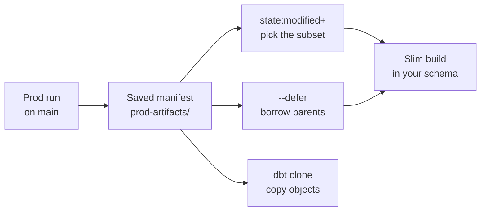
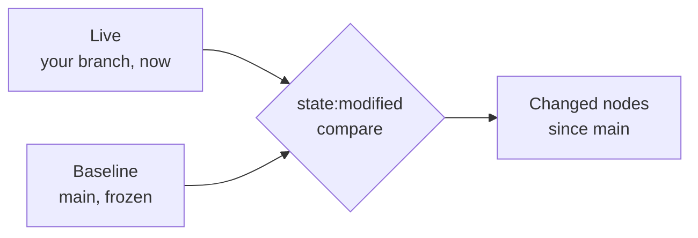
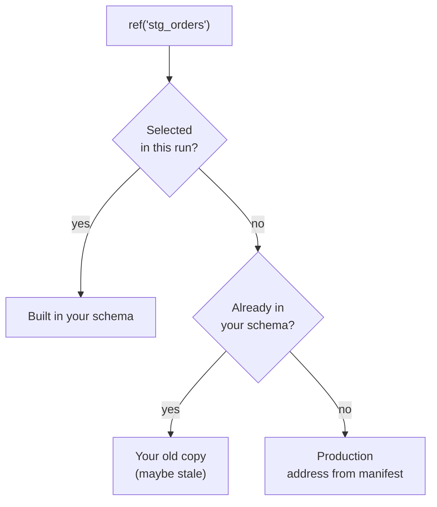
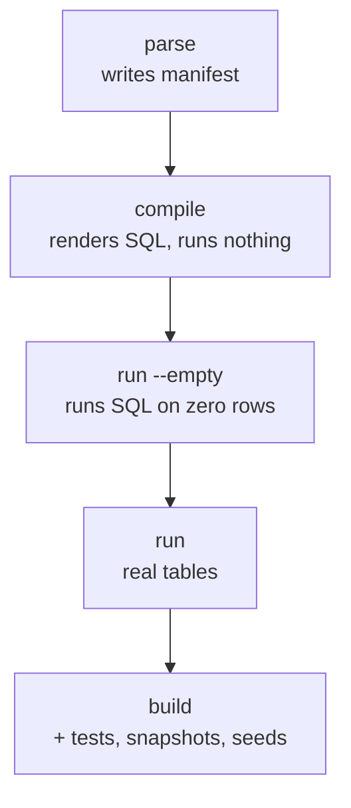
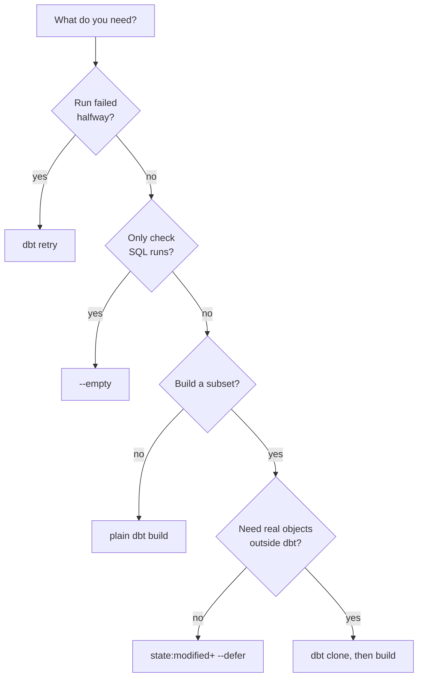

# dbt State, Defer, Clone, Retry and --empty: A Reading Guide

For: Rozie · Built on the M3 study sessions (19 Nov 2026) · Checked against docs.getdbt.com, Nov 2026
Length: about 6 A4 pages. Read one page at a time; each page stands on its own.
Companion: "dbt Materializations: A Reading Guide" (incremental and `--full-refresh` come back on page 4). CI/CD with GitHub Actions gets its own guide.

**Learning outcome:** after this guide you can explain, in your own words and without the docs, what the manifest/state is and how `state:modified+`, `--defer`, `dbt clone`, `dbt retry` and `--empty` each use it (or don't). Given a situation, you can pick the right one and say why. You can also run a slim build on your repo (`state:modified+ --defer --state ./prod-artifacts`), which is the base for the CI guide. Check: answer the 5 questions on page 6 correctly.

## Outline

1. The big picture: why dbt needs a memory, the five features, where they sit
2. The manifest and state: live vs baseline, its cycle, `state:modified+`
3. Defer: borrowing parents from production
4. Clone: real copies when borrowing is not enough
5. Retry: continue from the point of failure
6. `--empty`, the command ladder, the decision guide, check-yourself questions

How to read: every page follows the same order. The problem it solves, the mental model, a real example, when to use it, when not to, and the common mistake. Tags used: **Fact** (stated in the official docs), **Hypothesis** (likely, not verified), **Unknown** (could not verify).

Versions: your local dbt is 1.10.22 with dbt-duckdb; the cert is written for dbt Core 1.11. The docs now also describe dbt v2, so check the version selector when a detail matters.

---

## Page 1 · The big picture

### The problem

Today "correct" means "it ran on my laptop". A team needs every change checked before it reaches production, and it cannot afford to rebuild the whole project for every change.

The catch: **dbt has no memory**. Each run starts from nothing (Fact: dbt operations are stateless). It cannot tell what you changed, or where the production tables live, unless you hand it a record of an earlier run.

> These features give dbt a memory of **an earlier run**, so it can do **less work** in this one.

### The mental model: a photo of the project

- **Manifest** is a photo of the project, taken every time dbt runs: every model, its code, its config and the address of its table. It holds no data.
- **State** is you handing dbt an *old* photo (`--state <folder>`) so it can compare.
- **Defer** is borrowing a book from the library (production) instead of photocopying the library.
- **Clone** is photocopying only the books you actually need.
- **Retry** is picking up the job from the page where it stopped.
- **`--empty`** is a dress rehearsal: every step runs, but on an empty stage.

### The five features (Fact)

| Feature | Question it answers | Needs `--state`? | Writes tables? |
|---|---|---|---|
| `state:modified+` | What did I change, and what sits downstream? | Yes | No (it only selects) |
| `--defer` | Where do the unchanged parents live? | Yes | No (it rewrites refs) |
| `dbt clone` | Can I have real copies of production objects? | Yes | Yes |
| `dbt retry` | Can I continue from the failure? | No (uses `run_results.json`) | Depends on the command |
| `--empty` | Does my SQL run at all? | No | Yes, empty ones |

### Where they sit in the workflow



`--empty` and `retry` don't read the saved manifest. `--empty` is a cheap check before the build, and `retry` is the recovery step after a build fails.

### The one habit to build

**Keep two photos apart:** the one dbt keeps rewriting (`target/`), and the one you saved from production (`prod-artifacts/`). Almost every beginner bug on these pages comes from mixing them up.

---

## Page 2 · The manifest and state

### The problem

To answer "what did my PR change?", dbt needs two pictures: the project now, and the project in production. Git knows the difference in files, but dbt doesn't read Git.

### The model: two photos, two cycles

| | Live manifest | Baseline manifest |
|---|---|---|
| Path | `target/manifest.json` | `prod-artifacts/manifest.json` (any folder name) |
| Written by | every `parse`, `ls`, `compile`, `run`, `build` | you, `cp` after a run on `main` |
| Changes when | every command; overwrites the previous one | only when you replace it after `main` moves |
| `dbt clean` | Removed if `target/` is in `clean-targets` (Hypothesis: default; check yours) | Safe if kept outside `clean-targets` |
| `dbt deps` | Not touched | Not touched |



### A manifest is not Git

| | Git | Manifest |
|---|---|---|
| History | Every commit kept | Only the latest; older runs are overwritten |
| Branches | Yes | No; it is a file in a folder |
| Merge | Yes | Never; two folders = two separate files |
| Changes when | You commit | dbt runs (a push changes nothing by itself) |

- One manifest per `target/` folder. Your laptop, a teammate's laptop and each CI job each have their own.
- Hypothesis: two dbt runs in the same folder at once → the last writer wins. `--target-path` separates them.
- `dbt init` does not create a manifest; the first command that parses the project does.

### How `state:modified+` works (Fact)

- `--state <folder>` points dbt at the folder holding the baseline `manifest.json`. It is required for the `state:` selector, for deferral and for `dbt clone`.
- `state:modified` selects nodes that are new or changed compared with the baseline; the `+` adds everything downstream.
- dbt reads the file directly inside the folder you pass. `prod-artifacts/target/manifest.json` won't be found.

```bash
git checkout main && dbt parse
mkdir -p prod-artifacts && cp target/manifest.json prod-artifacts/
git checkout -b m3-state-test
# edit one model
dbt ls --select "state:modified+" --state ./prod-artifacts
```

### Worked example: one PR, two pushes

- Push 1 edits `int_order_financials` → selected: it and its downstream (assumed `fact_order`; check with `dbt ls`).
- Push 2 edits a second model → selected: **both** changes.

The baseline never moves, so the selection is **cumulative** since `main`, not "since the last push".

Hypothesis: if `main` has moved a lot since the baseline was saved, the selection can include changes that aren't yours. Rebase on `main` and refresh the baseline.

### Use it when
- You want to build or test only what a change touched.
- You have a baseline from a healthy production run.

### Do not use it when
- You have no baseline yet: you'll get `Got a state selector method, but no comparison manifest` (you hit this one).
- The project is tiny and a full build takes seconds.

### The common mistake

`--state ./target`. That compares the project with itself, so `state:modified` is always empty.

---

## Page 3 · Defer

### The problem

Your changed model refs parents you didn't touch. Building them all in your schema first is slow and costly.

### The model: borrow, don't photocopy

With `--defer`, a `ref()` to an unbuilt parent is compiled to the **production** table, using the address recorded in the baseline manifest. No data is copied; only the SQL changes.

### When a ref is deferred (Fact)

Both conditions must hold:

1. The node is **not selected** in this run.
2. The node **does not exist** in your target schema (unless `--favor-state` is set).



Other facts:
- Ephemeral models are never deferred; they only pass refs through.
- Tests follow the same rule: a `relationships` test on your model may read production for the other side.
- `--defer-state` lets you compare against one manifest and defer to another.

### Worked example

```bash
dbt build --select "state:modified+" --defer --state ./prod-artifacts
```

| Node | Selected? | Reads from |
|---|---|---|
| `stg_*` (unchanged) | No | Production, if absent from your schema |
| `int_order_financials` (changed) | Yes | Built in your schema |
| `fact_order` (downstream, assumed) | Yes, via `+` | Built in your schema |

To *see* defer without building, compile and read the SQL:

```bash
dbt compile --select fact_order --defer --state ./prod-artifacts
# open target/compiled/.../fact_order.sql and check the schema in each ref
```

Unknown: whether your DuckDB project has a separate production target for refs to point at. If it doesn't, the compiled refs will look odd. That's expected and doesn't mean defer is broken.

### Use it when
- You select a subset and want unchanged parents read from production.
- You test a few models in a large project.
- CI builds into a fresh PR schema (where defer works best).

### Do not use it when
- You need real objects in your schema for a BI tool or a person to query. Use clone (page 4).
- You select everything. Nothing is unselected, so nothing is deferred.

### Caveats (Fact)
- **Mixed environments:** one run can read production and dev together. Dev-only settings (a row limit, say) can change results.
- **Idempotence assumed:** the same manifest and the same raw data should give the same result.

### The common mistake

Running a full `dbt build` in dev, then wondering why defer "does nothing". The parents already exist in your schema, so condition 2 fails and you read your own copy, which may be stale.

---

## Page 4 · Clone

### First: what is a "target schema"?

The schema where dbt writes the models you build. It comes from the `target` in `profiles.yml`.

| Target | Target schema | Example object |
|---|---|---|
| prod | `analytics` | `analytics.fact_order` |
| dev (your laptop) | `dbt_rozie` | `dbt_rozie.fact_order` |
| CI (one per PR) | `pr_123` | `pr_123.fact_order` |

"Not in your target schema" means: no table with that name exists in `dbt_rozie` (or `pr_123`) yet.

### The problem

Defer only rewrites the `ref()` of **parents** inside dbt's compiled SQL. It creates nothing in your schema. That leaves two gaps:

1. **The model you are building is incremental.** `is_incremental()` checks whether *that model's own table* exists in your target schema. `{{ this }}` is not a `ref()`, so it is never deferred. In a fresh `pr_123` the table is missing, so dbt does a full rebuild of the whole table (Hypothesis: follows from how `is_incremental` works; not tested in your repo).
2. **Something outside dbt reads your schema.** A BI tool, a notebook or a SQL client pointed at `dbt_rozie` doesn't pass through dbt's compiler, so no `ref()` gets redirected. It sees an empty schema.

### Build vs defer vs clone (one model, `fact_order`)

| | What happens | Result in your schema | Cost |
|---|---|---|---|
| `dbt build` | Runs the SQL, computes the data | New table | High |
| `--defer` | Rewrites parent `ref()`s to `analytics.*` | Nothing | None |
| `dbt clone` | Creates an object from prod, no recompute | New object (clone or view) | Low |

Rule of thumb: **defer first; clone only for gap 1 or gap 2.**

### The model: photocopy only what you need

`dbt clone` creates real objects in your target schema, copied from the state you point at (Fact).

- On platforms with **zero-copy cloning** (Snowflake, Databricks, BigQuery), a production *table* becomes a clone: instant, no data duplicated (Fact).
- Otherwise dbt creates a **view** that does `select * from` the production object (Fact).
- By default, clone **does not recreate** relations that already exist in your target; `--full-refresh` forces it (Fact).

Hypothesis: on DuckDB you get the view fallback. Not verified.

```bash
dbt clone --state ./prod-artifacts                       # everything
dbt clone --select fact_order --state ./prod-artifacts   # one model
dbt clone --state ./prod-artifacts --full-refresh        # recreate existing
dbt clone --state ./prod-artifacts --threads 50          # clones are independent
```

### Clone vs defer (Fact)

| | Defer | Clone |
|---|---|---|
| What it does | Rewrites refs to production | Creates objects in your schema |
| Cost | No compute, no objects | Creates warehouse objects |
| Visible outside dbt (BI, SQL client) | No | Yes |
| Default choice | Yes, prefer it | When defer isn't enough |

### Worked example: the incremental model in CI (Fact: recommended use)

Your `fact_order` is incremental (M2). In a new PR schema:
1. Without clone: no table exists → `is_incremental()` = false → full rebuild of 10 million rows.
2. With clone as the first CI step: `dbt clone --select state:modified+,config.materialized:incremental --state ...` copies the production table → the build runs incrementally.

Hypothesis: the exact selector above is a common pattern; check the docs page before copying it.

### Use it when
- Incremental models in CI, to avoid a costly full refresh.
- You need to test a change against downstream BI dashboards.
- Blue/green deployments, or seeding a dev schema with current production.

### Do not use it when
- Defer already does the job. It's cheaper and leaves nothing behind.
- Your platform has no zero-copy clone and the views would confuse people about what's real.

### The common mistake

Expecting a second `dbt clone` to refresh objects that already exist. It skips them unless you pass `--full-refresh`.

---

## Page 5 · Retry

### The problem

`dbt build` fails at model 7 of 20. Running everything again rebuilds the six that already succeeded.

### The model: continue from the bookmark

`dbt retry` re-runs the **last invocation from the point of failure**. It doesn't re-run upstream nodes that succeeded (Fact).

### How it decides (Fact)

It reads `target/run_results.json` from the last run.

| Situation | What `retry` does |
|---|---|
| Model failed on a SQL error, you fixed it | Runs the failed node and anything downstream that didn't run |
| Failed before any node ran (connection, credentials, permissions) | Nothing; no nodes were recorded |
| Last run succeeded | Nothing ("Nothing to do") |
| You didn't fix the cause | The same error again |

Supported commands (Fact): `build`, `check`, `clone`, `compile`, `docs generate`, `run`, `run-operation`, `seed`, `snapshot`, `test`.

```bash
dbt build          # fact_order fails on a typo
# fix the typo
dbt retry          # rebuilds fact_order and what didn't run after it
```

Version note (Fact): in dbt v2, `--select` and `--exclude` on `retry` override the earlier selection. Treat that as v2 behaviour, not 1.11.

### Retry vs `result:` selectors

`--select result:error+ --state ./target` also re-runs failures (Fact: best-practice workflows). The docs note that `result:error` and `result:fail` combine in one command only with `dbt build`, because `dbt test` overwrites `run_results.json`. `retry` is the simpler tool for "continue where it stopped".

### Use it when
- A long run failed partway on something you can fix.
- An Airflow task failed and you want to resume, not restart (M5).

### Do not use it when
- The failure was a connection or permission error. Fix it and rerun the full command.
- You ran another dbt command in between: `run_results.json` now describes that run. (Hypothesis from how the file works.)

### The common mistake

Running `dbt retry` without fixing anything and expecting a different result.

---

## Page 6 · --empty, the command ladder, and the decision guide

### `--empty`

**Problem it solves:** you want to know whether the SQL compiles and runs (columns exist, joins resolve, refs are found) without paying to read the data.

**Model:** a dress rehearsal on an empty stage. Every `ref()` and `source()` is limited to zero rows; dbt still runs the model SQL against the warehouse and creates empty tables (Fact).

```bash
dbt build --empty
dbt run --select fact_order --empty
```

Facts:
- Available on `run` and `build` since dbt 1.8; `seed --empty` arrives in dbt 1.12.
- Python models ignore the flag.
- `flags.EMPTY` is true inside Jinja when the flag is passed.

**Use it when:**
- As the cheap first gate in CI, before the real build.
- After a rename or refactor on large data, to check nothing broke structurally.

**Do not use it when:**
- You want to know the numbers are right. It proves the SQL runs, not that the result is correct.
- On a small local DuckDB project, the saving is tiny. Try it once to read the SQL, then build normally.

**The common mistake:** trusting a green `--empty` CI run. Hypothesis: data tests on empty tables pass because no row can fail, so a wrong discount formula sails through. The real build and the M1 unit tests catch that.

### The command ladder



| Command | Writes tables? | What it proves |
|---|---|---|
| `parse` | No | The project reads; the manifest is written |
| `compile` | No | Jinja renders; refs resolve. The model SQL is **not** executed |
| `run --empty` | Empty ones | The SQL executes |
| `run` | Yes | Models build on real data |
| `build` | Yes | Models build **and** tests pass, in DAG order |

Hypothesis: `parse` and `compile` may still connect to the warehouse, for example for macros that run queries.

### The decision guide

| Situation | Choose |
|---|---|
| Only want to see where refs point | `compile --defer --state` |
| Does my SQL run at all? | `--empty` |
| Build only what my PR changed | `state:modified+` |
| …and borrow unchanged parents | `+ --defer --state` |
| Need real objects (BI, incremental in CI) | `dbt clone` |
| Run failed halfway, cause fixed | `dbt retry` |
| Tiny project, fast full build | plain `dbt build` |



**Prefer defer. Reach for clone only when something outside dbt needs to see the objects.**

### Applied to your repo (Hypothesis)

- Local learning: `prod-artifacts/` from `main`, a branch `m3-state-test`, `dbt ls` and `compile --defer` to observe.
- CI (M3 Week 5): lint → `build --empty` on `state:modified+` → clone the incremental `fact_order` → real `build --select state:modified+ --defer` into `pr_<n>`.
- `dbt-duckdb` on a data subset if the Snowflake trial has expired.

### Corrections from today's session

1. `compile` doesn't check that SQL works; it renders it. `run --empty` checks that it runs.
2. State isn't "bundled" with defer. State is the memory; defer is one of three readers (with `state:` selection and clone).
3. "Production" isn't a setting. It's whichever run the baseline manifest came from.
4. The manifest isn't per branch or per PR. It's per run, per `target/` folder.
5. A push doesn't change a manifest. Running dbt does; CI just runs dbt on every push.
6. `prod-artifacts` is a folder name you chose, not a dbt convention.

### Check yourself (answer in your own words, no docs)

1. You run `dbt ls`, then `dbt compile`. Which manifest changed, and which didn't?
2. `stg_orders` exists in your dev schema from last week. Does `--defer` read it or production? Why?
3. Your incremental `fact_order` does a full rebuild in every PR. Which feature fixes this, and how?
4. `dbt build` fails on a wrong password. You fix it and run `dbt retry`. What happens?
5. CI is green with `--empty`, but a discount bug reaches `main`. Why?

Questions 1 to 3 tell us whether the state/defer/clone model is stable before the CI guide.

---

### Sources

- [dbt docs: State selection](https://docs.getdbt.com/reference/node-selection/state-selection)
- [dbt docs: Defer](https://docs.getdbt.com/reference/node-selection/defer)
- [dbt docs: dbt clone](https://docs.getdbt.com/reference/commands/clone)
- [dbt docs: dbt retry](https://docs.getdbt.com/reference/commands/retry)
- [dbt docs: About the --empty flag](https://docs.getdbt.com/docs/build/empty-flag) (read through a search excerpt only)
- [dbt docs: dbt build](https://docs.getdbt.com/reference/commands/build)
- [dbt docs: Best-practice workflows](https://docs.getdbt.com/best-practices/best-practice-workflows)
- Items marked Hypothesis or Unknown were not verified; check them before relying on them.

### Personal learning notes / interesting points

1.
2.
3.
