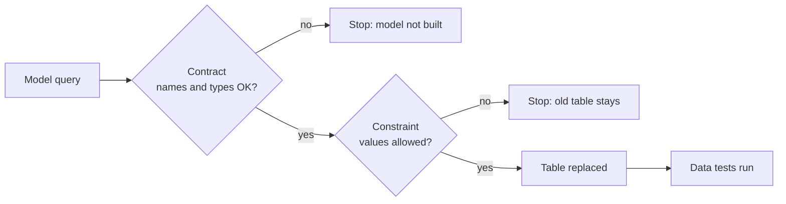

# dbt Governance: A Short Reading Guide

**For:** M4. **Time:** about 45 minutes, one section per loop. Do not read it all at once.

Tags: **Docs** = official dbt documentation. **Observed** = tested on 27 Nov 2026 with dbt 1.10.22 + dbt-duckdb 1.10.0 in a throwaway project (not this one). **Unknown** = not tested.

## My notes (read this first)

_(empty: write in my own words after each section)_

---

## 0 · The big picture

**What each feature protects**

| Feature | Protects |
|---|---|
| contract + constraint | **shape (name & type) and values** |
| version | **how it changes** |
| group + access | **who may depend on it** |
| exposure | **who already depends on it**, outside dbt |

`group` + `access` control `ref()` in dbt code, not who can query the table (that is `grants`).

**Problem.** Other people and tools (marts, BI, an AI agent) read my models. If a column is renamed or its type changes, they break, often silently.

**Where it fits.** Testing asks "is the data right?". CI asks "is this change safe to merge?". Governance asks "what did I **promise** the people who use this model?"

**Analogy.** A restaurant menu.

| Feature | Menu analogy | Question | Section |
|---|---|---|---|
| Contract (shape) | every dish lists exactly what is on the plate | Is the shape what I promised? | 1 |
| Constraint (values) | kitchen refuses to serve a spoiled ingredient | Can bad rows get in? | 1 |
| Version + deprecation | new menu, old one available until a date | How do I change a promise? | 2 |
| Access + group | staff-only kitchen | Who may `ref()` this? | 3 |
| Exposure | list of regular customers | Who is affected if I change it? | 4 |

---

## 1 · Contracts and constraints

### Where they sit in the DAG

```text
sources -> staging -> intermediate -> core / marts -> BI, AI agent
\______ data tests, freshness ______/  \_ contract + constraint _/
        check the raw material            promise to consumers
                                         (data tests stay here too)
```

- Contracts and constraints go **where others depend on the model**, here `fact_order` and `fact_order_item`.
- Upstream models change often, so a contract there means editing YAML for every column change.
- Constraints do not work on views, and my staging and intermediate models are views.
- Sources cannot have a contract.
- The rule is **who depends on it**, not the layer name: an intermediate model used by another team deserves a contract.

Analogy: ingredients are checked at the kitchen door (tests); the promised menu is on the guest's table (contract).

### Four checks at a glance

| | **Contract** | **Constraint** | **Data test** | **Unit test** |
|---|---|---|---|---|
| **What it checks** | **shape**: names, types | **values**, row by row | **values**, any SQL rule | SQL **logic** |
| **When** | before the build | during the write | after the build | before the build |
| **Data used** | no values | real data | real data | fake rows in YAML |
| **If it fails** | old table stays | old table stays | bad data is already in; downstream skipped | model not built |
| **Where in YAML** | `config: contract:` + `name`, `data_type` | `constraints:` | `data_tests:` (or `tests/*.sql`) | `unit_tests:` |

Order in `dbt build`: unit test -> contract -> build with constraints -> data tests.

### Contract (Ensure Shape: Name and Type)

A contract fixes the **column names and data types** of a model.

```yaml
models:
  - name: dim_example
    config:
      contract: {enforced: true}
    columns:
      - name: id
        data_type: integer
        constraints:
          - type: not_null
      - name: city
        data_type: varchar
```

Rules (**Docs**):

- **Every** column needs `name` and `data_type`, not only the important ones.
- Works on `table`, `view` (names and types only) and `incremental` with `on_schema_change` = `append_new_columns` or `fail`.
- Not supported: `ephemeral`, materialized views, Python models, sources, seeds, snapshots.
- dbt checks the query's columns against the YAML **before** building. Column order does not matter.

**Observed:** a wrong type or an undeclared column stops the build with a table showing `definition_type` vs `contract_type`.

### Constraints (Ensure Values)

Rules the **database** applies while writing: `not_null`, `unique`, `primary_key`, `foreign_key`, `check`. They need an enforced contract, and only work on tables and incrementals (**Docs**).

Enforcement depends on the platform. This is a common exam trap.

| Platform | Enforced | Source |
|---|---|---|
| Snowflake | `not_null` only; keys are metadata | Docs |
| BigQuery | `not_null`; keys are metadata | Docs |
| Redshift | `not_null` only | Docs |
| Postgres | all, including `check` | Docs |
| DuckDB | `not_null`, `check`, `primary_key` | Observed |

**Observed:** when a constraint failed, the existing table kept its old rows.
**Unknown:** `foreign_key` on DuckDB; constraints on an incremental `merge`; speed on 10M rows.

### When to use which

| Use | When | Example in this project |
|---|---|---|
| **Data test** (default) | almost any data rule; can be `warn` only | `relationships` to `dim_customer`; discount not above subtotal |
| **Contract** | others depend on the model and its shape must stay stable | `fact_order`, read by marts and AI text-to-SQL |
| **Constraint** | a bad row must **never** get in, and the platform really enforces it | `order_id` is never null |

They are layers, not replacements:

```text
stg_*, int_*   -> data tests are enough
fact_order     -> contract + a few constraints + data tests
```

Analogy (sending a parcel): contract = check the box size before packing; constraint = the guard refuses a banned item while it goes in; test = quality check by opening the box afterwards.

### How to choose

```text
Afraid the SHAPE will change?                 -> contract
Bad VALUES must never get in?                 -> constraint (on top of a contract)
Being told about bad values is enough?        -> data test (can be warn)
```

### How contract and constraint relate

One direction only: a contract works **without** constraints; constraints do **not** work without a contract.

Inside **one model**:

```text
+- one model ----------------------------------------+
|                                                    |
|   +- contract (shape) ------+     data tests       |
|   |                         |     (values or logic)|
|   |  +- constraint -------+ |     independent      |
|   |  |  (values)          | |                      |
|   |  +--------------------+ |                      |
|   +-------------------------+                      |
+----------------------------------------------------+
```

- A constraint **depends on** the contract, but it checks something else (values, not shape).
- A data test needs neither, and may guard the same rule as a constraint (`order_id` not null): the constraint blocks it while writing, the test reports it afterwards.

Analogy: a lock (constraint) needs a door (contract); a CCTV camera (data test) can be installed anywhere, also watching that locked door.



**Case:** `order_id` is declared `bigint`, and one row is `NULL`.

| Check | Result |
|---|---|
| Contract: is there an `order_id` of type `bigint`? | passes (`NULL` still has a type) |
| Constraint `not_null` | **fails** |

**Why a constraint needs a contract:** it is written into the `CREATE TABLE` statement, and dbt can only write that statement when every column and type is declared.

```sql
CREATE TABLE fact_order (
    order_id BIGINT NOT NULL    -- type from the contract, NOT NULL from the constraint
);
```

Analogy (a form): the contract makes sure there is an "age" field that holds a number; the constraint refuses an empty or negative age. `-5` is still a number.

**Common mistake:** declaring `primary_key` on Snowflake and assuming duplicates are blocked. Keep the `unique` test.

---

## 2 · Versions and deprecation (TRANSITIONING SMOOTHLY)

Tags: **Fact** = observed in my own runs; **Observed** and **Docs** as defined at the top.

### 2.1 The problem it solves

**Problem:** someone else uses my table, and I need to change it in a way that would break their query.

**Answer:** do not change it in place. Keep the old one running, put the new one next to it, and give people time to move.

Versioning needs only three decisions:

| In plain words | In dbt | Required? | If not written |
|---|---|---|---|
| the old one and the new one | `v: 1`, `v: 2` | yes | there are no versions |
| which one is official | `latest_version` | optional (**Docs**) | the **highest** number |
| when people should be gone from the old one | `deprecation_date` | optional | nobody is told to leave |

`deprecation_date` is **only a label**: it warns, it does not drop or block anything. After the date the old table can still be queried; removing it is manual.

**Trap:** adding `v: 2` without `latest_version` makes v2 official at once.

Example (hypothetical marts): v2 renames `sales_amount` to `gross_sales_amount`, and marts A and B still select `sales_amount`.

| Mart | It calls | No `latest_version` | `latest_version: 1` |
|---|---|---|---|
| A | `ref('fact_order')` | gets v2, **breaks** | gets v1, safe |
| B | `ref('fact_order', v=1)` | gets v1, safe | gets v1, safe |

Release safely: keep `latest_version: 1`, let mart A move or pin, then switch to `2`.

### 2.2 When to use a new version

| Situation | New version? |
|---|---|
| Rename or drop a column that others use | **yes** |
| Change a type, grain or metric definition | **yes** |
| Consumers need time to migrate | **yes** |
| Add a column | no |
| Internal model, or all consumers change in the same PR | no |
| Same result, different build (table to incremental) | no (my current v2 is this: practice only) |

### 2.3 Syntax

**Basic** (enough for most cases):

```yaml
models:
  - name: fact_order          # what ref() uses
    latest_version: 1         # the official one; if omitted: highest v
    versions:                 # a key inside the model, NOT "- versions:"
      - v: 1
        deprecation_date: 2027-01-31
      - v: 2
```

By default the files are `fact_order_v1.sql` and `fact_order_v2.sql`, and the tables have the same names. Change that only if needed: `defined_in` (file), `config: alias:` (table).

What I have now in `fact_order.yml`:

```yaml
  - name: fact_order
    latest_version: 2
    versions:
      - v: 2
        defined_in: fact_order_v2
        config:
          alias: fact_order
      - v: 1                        # file fact_order_v1.sql, table fact_order_v1
```

** (OPTIONAL, Contract related) Add this only when a column differs** (here, a rename). **Observed:** builds with an enforced contract.

```yaml
      - v: 2
        columns:
          - include: all
            exclude: [sales_amount]
          - name: gross_sales_amount
            data_type: decimal(18,2)    # needed when the contract is enforced
```

### 2.4 Three names, three jobs

Easy to mix up. This was most of my debugging.

| Name | What it is | Where it comes from |
|---|---|---|
| **Model name** | What `ref()` uses: `ref('fact_order', v=2)` | `name:` in yml |
| **File name** | Where the SQL lives | `defined_in`, default `<model>_v<v>.sql` |
| **Table name** | What appears in DuckDB/Snowflake | `alias`, default `<model>_v<v>` |

- **Fact:** `ref('fact_order_v2')` fails once versioning is on. `fact_order_v2` is a file name, not a model name.
- **Fact:** `dbt build -s fact_order_old` matched nothing (that was my first name for the v1 file). `-s` uses `fact_order_v1` or `fact_order.v1`.
- **Fact:** `fact_order_v2` worked as a selector only because the file name happened to equal the version name.
- **Docs (recall, not re-checked):** `v` can be a number or a string, but the `_v<value>` pattern in default names and selectors stays.
- Simplest setup (what I use now): name files `fact_order_v1.sql` and `fact_order_v2.sql`, and skip `defined_in`.

### 2.5 What I learned on `fact_order_item`

The change: v2 renames `line_amount_delta` to `amount_delta`.

**1. Rename the file and add `versions:` together.**
Renaming alone broke every `ref()`: `depends on a node named 'fact_order_item' which was not found`.

**2. Move consumers before raising `latest_version`.**
Raising it first broke the mart: no column `line_amount_delta`.

**3. Move `latest_version` and `alias` together.**
With only `latest_version` moved, the plain table still showed the old column.

**4. Clean up old tables yourself.**
`fact_order_item_v2` stayed behind after the alias moved, and was no longer updated.

### 2.6 Retiring a version

**Example** (`fact_order_item`):

```yaml
# step 1: announce the deadline (done)
latest_version: 2
versions:
  - v: 1
    defined_in: fact_order_item_v1
    deprecation_date: 2027-01-31
  - v: 2
    config: {alias: fact_order_item}
```

Step 2: everyone still on `ref('fact_order_item', v=1)` moves to v2.

```yaml
# step 3: after everyone moved, remove v1 and delete fact_order_item_v1.sql
latest_version: 2
versions:
  - v: 2
    config: {alias: fact_order_item}
```

Step 4: `DROP TABLE dev.fact_order_item_v1;` (and in every other schema that has it).

- **Observed:** a reference to a version with a future date warns: `Found a reference to ... slated for deprecation on ...`.
- **Observed:** with nobody referencing v1, `dbt parse` showed no warning.
- **Docs:** dbt never drops the old table; that is manual.

### 2.7 Breaking changes and contracts

**Breaking** (**Docs**): removing a column, changing a type, removing or changing a constraint, or removing a contracted model. Adding a column is not.

Only a comparison with an earlier manifest (`--state`) detects it:

| Case: type changed in **both** SQL and YAML | Result (**Observed**) |
|---|---|
| No `--state` | builds fine, nobody notices |
| `--state`, model **not** versioned | warning only |
| `--state`, model **versioned** | error: "Breaking change to contract" |

---

## 3 · Access and groups

A **group** is a named set of models with an owner. **Access** says who may `ref()` a model.

| `access` | Who can `ref()` it |
|---|---|
| `private` | models in the same group |
| `protected` (default) | any model in the same project (or installed package) |
| `public` | any group, package or project |

| `access` | Analogy | Example |
|---|---|---|
| `private` | team-only kitchen | a building block that still changes often |
| `protected` | office room | most models |
| `public` | public lobby | an official shared model, e.g. `fact_order` |

```text
              same group   same project   other project
private           yes           no              no
protected         yes           yes             no *
public            yes           yes             yes
```

\* unless that project installs mine as a package; `restrict-access` can limit this.

- Writing nothing means `protected`.
- `public` usually comes with a contract and versions, because other teams may depend on it.
- `public` is only about `ref()`, not about exposing data to the internet.
- An `ephemeral` model cannot be `public`.
- In a single project, `public` and `protected` behave the same; only `private` can be demonstrated.

```yaml
groups:
  - name: finance
    owner: {name: Finance team}

models:
  - name: int_example
    config:
      group: finance
      access: private
```

Breaking the rule fails at **parse** time: `... is not allowed because the referenced node is private to the '<group>' group.`

**Exam trap:** this only controls `ref()`. Anyone with a SQL client can still query the table; that needs `grants`.

### Where it is written

```text
dbt-project/
  dbt_project.yml          <- optional: +group for a whole folder
  models/
    _groups.yml            <- defines the group ONCE (name + owner)
    intermediate/order/int_order_financials/
      int_order_financials.yml   <- this model: config: group + access
    core/fact_order/
      fact_order.yml             <- this model: config: group
```

- `_groups.yml` lives **inside** `models/`; the file name is my choice, the `groups:` key is what dbt reads.
- Each model states its own membership and access in its YAML.
- The key is `group:` (singular) under `config`. A typo such as `groups:` is silently ignored.

### `meta`: free-form labels

`meta` holds any key and value I want. **Observed:** these parse on a group and on a model, and appear in `manifest.json`.

```yaml
groups:
  - name: product_platform
    description: "Order and product data"
    owner:
      name: Product Platform team
    config:
      meta:
        slack: "#data-product"
        oncall: weekdays

models:
  - name: int_example
    config:
      group: product_platform
      access: private
      meta:
        owner: Product Platform team
        contains_pii: false
```

dbt **enforces nothing** from `meta`: it is information for people and tools (docs site, catalog, alert routing, scripts). `contains_pii: true` does not hide or protect any data.

| | Does dbt enforce it? |
|---|---|
| `access` | yes, `ref()` is blocked |
| `group` | yes, together with `private` |
| `meta`, `tags` | no (`tags` are used for selection) |

Analogy: `meta` is a sticky note on a folder; `access` is the lock.

### `tags`: labels for selection

```yaml
# dbt_project.yml: a whole folder
models:
  dbt_cert_prep:
    core:
      +tags: [core]

# or one model, in its YAML
models:
  - name: fact_order
    config:
      tags: [finance]
```

```bash
dbt build -s tag:core          # run everything labelled core
```

Tags answer "**what do I run together?**". They block nothing and have no owner. Not tried in this project yet.

---

## 4 · Exposures

A description of something **outside** dbt that uses my models.

```yaml
exposures:
  - name: example_dashboard
    type: dashboard          # dashboard | notebook | analysis | ml | application
    owner: {name: Someone}
    depends_on:
      - ref('fact_order')
```

Required: `name`, `type`, `owner` (name or email). `depends_on` is expected (**Docs**).

Value: it appears in lineage, and I can select everything it needs:

```bash
dbt build -s +exposure:example_dashboard
```

It builds nothing by itself and checks nothing about the app. **Common mistake:** expecting it to alert the app owner.

---

## Check yourself

1. SQL returns `varchar`, YAML says `integer`. What happens, and when?
2. Contract passes but the table has duplicate IDs. How is that possible?
3. I change a type in SQL and YAML. What makes dbt complain?
4. `private` model: can an analyst still query its table?
5. What does an exposure change when I run `dbt build`?

## Sources

[Model contracts](https://docs.getdbt.com/docs/mesh/govern/model-contracts) · [Constraints](https://docs.getdbt.com/reference/resource-properties/constraints) · [Model versions](https://docs.getdbt.com/docs/mesh/govern/model-versions) · [deprecation_date](https://docs.getdbt.com/reference/resource-properties/deprecation_date) · [Model access](https://docs.getdbt.com/docs/mesh/govern/model-access) · [Groups](https://docs.getdbt.com/docs/build/groups) · [Exposures](https://docs.getdbt.com/docs/build/exposures)

The docs pages do not state clearly which dbt version they show. The exam targets Core 1.11; re-check details there.
