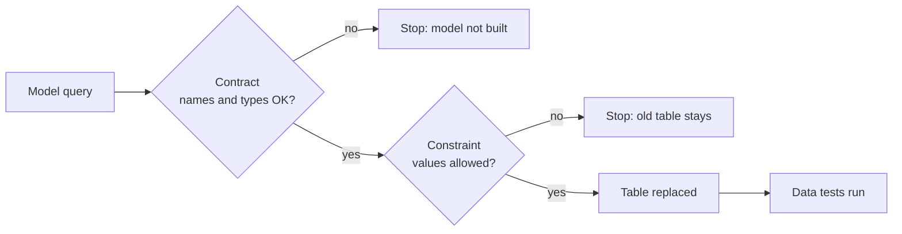

# dbt Governance: A Short Reading Guide

**For:** M4. **Time:** about 45 minutes, one section per loop. Do not read it all at once.

Tags: **Docs** = official dbt documentation. **Observed** = tested on 27 Nov 2026 with dbt 1.10.22 + dbt-duckdb 1.10.0 in a throwaway project (not this one). **Unknown** = not tested.

## My notes (read this first)

_(empty: write in my own words after each section)_

---

## 0 · The big picture

**What each feature protects**

| Feature | Protects |
|---|---|
| contract + constraint | **shape (name & type) and values** |
| version | **how it changes** |
| group + access | **who may depend on it** |
| exposure | **who already depends on it**, outside dbt |

`group` + `access` control `ref()` in dbt code, not who can query the table (that is `grants`).

**Problem.** Other people and tools (marts, BI, an AI agent) read my models. If a column is renamed or its type changes, they break, often silently.

**Where it fits.** Testing asks "is the data right?". CI asks "is this change safe to merge?". Governance asks "what did I **promise** the people who use this model?"

**Analogy.** A restaurant menu.

| Feature | Menu analogy | Question | Section |
|---|---|---|---|
| Contract (shape) | every dish lists exactly what is on the plate | Is the shape what I promised? | 1 |
| Constraint (values) | kitchen refuses to serve a spoiled ingredient | Can bad rows get in? | 1 |
| Version + deprecation | new menu, old one available until a date | How do I change a promise? | 2 |
| Access + group | staff-only kitchen | Who may `ref()` this? | 3 |
| Exposure | list of regular customers | Who is affected if I change it? | 4 |

---

## 1 · Contracts and constraints

### Where they sit in the DAG

```text
sources -> staging -> intermediate -> core / marts -> BI, AI agent
\______ data tests, freshness ______/  \_ contract + constraint _/
        check the raw material            promise to consumers
                                         (data tests stay here too)
```

- Contracts and constraints go **where others depend on the model**, here `fact_order` and `fact_order_item`.
- Upstream models change often, so a contract there means editing YAML for every column change.
- Constraints do not work on views, and my staging and intermediate models are views.
- Sources cannot have a contract.
- The rule is **who depends on it**, not the layer name: an intermediate model used by another team deserves a contract.

Analogy: ingredients are checked at the kitchen door (tests); the promised menu is on the guest's table (contract).

### Four checks at a glance

| | **Contract** | **Constraint** | **Data test** | **Unit test** |
|---|---|---|---|---|
| **What it checks** | **shape**: names, types | **values**, row by row | **values**, any SQL rule | SQL **logic** |
| **When** | before the build | during the write | after the build | before the build |
| **Data used** | no values | real data | real data | fake rows in YAML |
| **If it fails** | old table stays | old table stays | bad data is already in; downstream skipped | model not built |
| **Where in YAML** | `config: contract:` + `name`, `data_type` | `constraints:` | `data_tests:` (or `tests/*.sql`) | `unit_tests:` |

Order in `dbt build`: unit test -> contract -> build with constraints -> data tests.

### Contract (Ensure Shape: Name and Type)

A contract fixes the **column names and data types** of a model.

```yaml
models:
  - name: dim_example
    config:
      contract: {enforced: true}
    columns:
      - name: id
        data_type: integer
        constraints:
          - type: not_null
      - name: city
        data_type: varchar
```

Rules (**Docs**):

- **Every** column needs `name` and `data_type`, not only the important ones.
- Works on `table`, `view` (names and types only) and `incremental` with `on_schema_change` = `append_new_columns` or `fail`.
- Not supported: `ephemeral`, materialized views, Python models, sources, seeds, snapshots.
- dbt checks the query's columns against the YAML **before** building. Column order does not matter.

**Observed:** a wrong type or an undeclared column stops the build with a table showing `definition_type` vs `contract_type`.

### Constraints (Ensure Values)

Rules the **database** applies while writing: `not_null`, `unique`, `primary_key`, `foreign_key`, `check`. They need an enforced contract, and only work on tables and incrementals (**Docs**).

Enforcement depends on the platform. This is a common exam trap.

| Platform | Enforced | Source |
|---|---|---|
| Snowflake | `not_null` only; keys are metadata | Docs |
| BigQuery | `not_null`; keys are metadata | Docs |
| Redshift | `not_null` only | Docs |
| Postgres | all, including `check` | Docs |
| DuckDB | `not_null`, `check`, `primary_key` | Observed |

**Observed:** when a constraint failed, the existing table kept its old rows.
**Unknown:** `foreign_key` on DuckDB; constraints on an incremental `merge`; speed on 10M rows.

### When to use which

| Use | When | Example in this project |
|---|---|---|
| **Data test** (default) | almost any data rule; can be `warn` only | `relationships` to `dim_customer`; discount not above subtotal |
| **Contract** | others depend on the model and its shape must stay stable | `fact_order`, read by marts and AI text-to-SQL |
| **Constraint** | a bad row must **never** get in, and the platform really enforces it | `order_id` is never null |

They are layers, not replacements:

```text
stg_*, int_*   -> data tests are enough
fact_order     -> contract + a few constraints + data tests
```

Analogy (sending a parcel): contract = check the box size before packing; constraint = the guard refuses a banned item while it goes in; test = quality check by opening the box afterwards.

### How to choose

```text
Afraid the SHAPE will change?                 -> contract
Bad VALUES must never get in?                 -> constraint (on top of a contract)
Being told about bad values is enough?        -> data test (can be warn)
```

### How contract and constraint relate

One direction only: a contract works **without** constraints; constraints do **not** work without a contract.

Inside **one model**:

```text
+- one model ----------------------------------------+
|                                                    |
|   +- contract (shape) ------+     data tests       |
|   |                         |     (values or logic)|
|   |  +- constraint -------+ |     independent      |
|   |  |  (values)          | |                      |
|   |  +--------------------+ |                      |
|   +-------------------------+                      |
+----------------------------------------------------+
```

- A constraint **depends on** the contract, but it checks something else (values, not shape).
- A data test needs neither, and may guard the same rule as a constraint (`order_id` not null): the constraint blocks it while writing, the test reports it afterwards.

Analogy: a lock (constraint) needs a door (contract); a CCTV camera (data test) can be installed anywhere, also watching that locked door.



**Case:** `order_id` is declared `bigint`, and one row is `NULL`.

| Check | Result |
|---|---|
| Contract: is there an `order_id` of type `bigint`? | passes (`NULL` still has a type) |
| Constraint `not_null` | **fails** |

**Why a constraint needs a contract:** it is written into the `CREATE TABLE` statement, and dbt can only write that statement when every column and type is declared.

```sql
CREATE TABLE fact_order (
    order_id BIGINT NOT NULL    -- type from the contract, NOT NULL from the constraint
);
```

Analogy (a form): the contract makes sure there is an "age" field that holds a number; the constraint refuses an empty or negative age. `-5` is still a number.

**Common mistake:** declaring `primary_key` on Snowflake and assuming duplicates are blocked. Keep the `unique` test.

---

## 2 · Versions and deprecation

Moved here from the M2 folder; first written from my `fact_order` v1/v2 experiment. Tags in 2.1-2.8: **Fact** = observed in my own runs; **Docs (recall)** = from memory of the docs, not re-checked.

### 2.1 The problem it solves

A model has consumers (dashboards, other teams, downstream models). I want to make a **breaking change**: rename or drop a column, change a type, change the grain, change a metric definition. If I edit in place, every consumer breaks at once. If I create `fact_order_new` by hand, nobody knows which one is official.

**Model versions** let `v1` and `v2` live side by side. Consumers move one at a time, then `v1` is retired.

Not breaking, so no versioning needed: adding a column (that is `on_schema_change`), or an internal model only I use.

#### Example from my project

`fact_order.sales_amount` is used by a mart (`SUM(sales_amount)`), a BI dashboard ("Total Sales") and ad-hoc analyst queries. I want to rename it to `gross_sales_amount`.

- **Edit in place:** all three break at the same moment ("column not found"). None of them had time to change.
- **`fact_order_new` by hand:** nothing breaks, but there are two similar tables. Nobody knows which is official or when the old one dies.
- **Model versions:** v1 keeps `sales_amount`, v2 has `gross_sales_amount`. One name, a marked latest, and consumers migrate one by one.

| Change | Old consumers |
|---|---|
| Rename or drop a column | break with an error |
| Change a type | can break |
| Change grain or metric definition | **no error, numbers silently change** (the most dangerous) |
| Add a column | safe |

#### Versioning = gradual sunset

It is a deprecation lifecycle, not just a version label. It gives three things:
- **Coexistence:** v1 and v2 live together, so nothing breaks suddenly.
- **Official marker:** `latest_version` says which one is recommended.
- **Deadline:** `deprecation_date` on v1 warns consumers still using it. **Docs (recall)**, not tested.

Without the deadline it is only "two versions forever".

Limit: versioning only covers the dbt side. A BI dashboard outside dbt is not notified automatically. Telling its users is a team process, not a dbt feature.

### 2.2 Mental model

One model name, many versions. The name is shared; the version is the extra address.

```
fact_order
 ├─ v1  -> file fact_order_v1.sql   -> table fact_order_v1
 └─ v2  -> file fact_order_v2.sql   -> table fact_order   (latest)
```

`ref('fact_order')` with no version goes to `latest_version`. `ref('fact_order', v=1)` pins a version.

### 2.3 Config (what I ran)

In the model's properties `.yml`, `versions:` is a key **inside** the model (same level as `name:`), not a new list item:

```yaml
models:
  - name: fact_order
    latest_version: 2
    columns: ...            # shared by all versions
    versions:
      - v: 2
        defined_in: fact_order_v2   # SQL file name, no .sql
        config:
          alias: fact_order         # warehouse table name
      - v: 1                        # defined_in omitted: default is fact_order_v1.sql
```

### 2.4 Three names, three jobs

Easy to mix up. This was most of my debugging.

| Name | What it is | Where it comes from |
|---|---|---|
| **Model name** | What `ref()` uses: `ref('fact_order', v=2)` | `name:` in yml |
| **File name** | Where the SQL lives | `defined_in`, default `<model>_v<v>.sql` |
| **Table name** | What appears in DuckDB/Snowflake | `alias`, default `<model>_v<v>` |

- **Fact:** `ref('fact_order_v2')` fails once versioning is on. `fact_order_v2` is a file name, not a model name.
- **Fact:** `dbt build -s fact_order_old` matched nothing (that was my first name for the v1 file). `-s` uses `fact_order_v1` or `fact_order.v1`.
- **Fact:** `fact_order_v2` worked as a selector only because the file name happened to equal the version name.
- **Docs (recall):** `v` can be a number or a string, but the `_v<value>` pattern in default names and selectors stays.
- Simplest setup (what I use now): name files `fact_order_v1.sql` and `fact_order_v2.sql`, and skip `defined_in`.

### 2.5 Gotchas I hit

1. **`versions:` indentation.** Writing `- versions:` made a second list item under `models`. Error: `list element for 'models' does not have a name attribute`.
2. **`latest_version` needs a `versions:` block.** Only `latest_version: 2` is not enough.
3. **`defined_in` must match the real file name.** I renamed `fact_order.sql` and the yml still pointed at the old name. Warning: `Did not find matching node for patch with name 'fact_order'`.
4. **Analyses and tests with old refs break parse.** Plain `ref('fact_order')` now means the latest version. Compare old vs new with `v=1` and `v=2`.
5. **Stale parse cache.** After removing versioning, dbt said `fact_order.v2 ... is not in the graph`. Fix: `dbt --no-partial-parse parse`.
6. **A new alias means a new table.** v1 now builds to `fact_order_v1`, which did not exist. Audit macros then saw no columns and `dbt show` failed with `syntax error at or near "limit"`. Build the version first.
7. **Reusing an alias reuses the table.** v2 (incremental) with `alias: fact_order` merged into the old `fact_order` table. For a clean build: `dbt build -s fact_order_v2 --full-refresh`.

### 2.6 When to use, when not to

**Use when**
- The model is shared (BI, other teams, other projects) and the change is breaking.
- Consumers need a migration window.
- Paired with governance: contracts and `public` access (M4). **Docs (recall)**

**Do not use when**
- The model is internal, or all consumers can change in one PR.
- The change is additive (new column).
- The result is identical and only the build changes. My `fact_order` v2 (table to incremental, same data) is this case. In production I would just change the materialization. Here it is a practice run.

### 2.7 Retiring a version

- **Docs (recall):** `deprecation_date` on the old version produces warnings for consumers still using it.
- Migrate consumers to `v=2` one by one, then delete v1 and its entry in `versions:`.
- **Docs:** it does not delete the model or its table.
- **Observed:** a past date gives a warning at parse, not an error.
- **Unknown:** how `include`/`exclude` of columns per version behaves on this project. Not tested.

### 2.8 Check-yourself

1. What does `ref('fact_order')` return when `latest_version: 2`? What about `ref('fact_order', v=1)`?
2. Name the three names (model, file, table) and where each is set.
3. Why would `-s` with a file name like `fact_order_old` match nothing?
4. Is adding a column a reason to create v2?
5. v2 uses `alias: fact_order` and v1 has no alias. Which table does v1 build to?

### 2.9 Added for M4: contracts and versions

**Different columns per version** (**Docs**, not tested here). Shared columns stay at the top; each version says what differs:

```yaml
versions:
  - v: 2
    columns:
      - include: all
        exclude: [old_name]
      - name: new_name
        data_type: varchar      # needed when the contract is enforced
  - v: 1
```

**A breaking change** (**Docs**) is: removing a column, changing a type, removing or changing a constraint, or removing a contracted model. Adding a column is not breaking.

**Who detects it.** Only a comparison with an earlier manifest (`--state`).

| Case: type changed in **both** SQL and YAML | Result (**Observed**) |
|---|---|
| No `--state` | builds fine, nobody notices |
| `--state`, model **not** versioned | warning only |
| `--state`, model **versioned** | error: "Breaking change to contract" |

So a contract alone catches "SQL no longer matches YAML". It does not catch someone changing both.

---

## 3 · Access and groups

A **group** is a named set of models with an owner. **Access** says who may `ref()` a model.

| `access` | Who can `ref()` it |
|---|---|
| `private` | models in the same group |
| `protected` (default) | any model in the same project (or installed package) |
| `public` | any group, package or project |

| `access` | Analogy | Example |
|---|---|---|
| `private` | team-only kitchen | a building block that still changes often |
| `protected` | office room | most models |
| `public` | public lobby | an official shared model, e.g. `fact_order` |

```text
              same group   same project   other project
private           yes           no              no
protected         yes           yes             no *
public            yes           yes             yes
```

\* unless that project installs mine as a package; `restrict-access` can limit this.

- Writing nothing means `protected`.
- `public` usually comes with a contract and versions, because other teams may depend on it.
- `public` is only about `ref()`, not about exposing data to the internet.
- An `ephemeral` model cannot be `public`.
- In a single project, `public` and `protected` behave the same; only `private` can be demonstrated.

```yaml
groups:
  - name: finance
    owner: {name: Finance team}

models:
  - name: int_example
    config:
      group: finance
      access: private
```

### `meta`: free-form labels

`meta` holds any key and value I want. **Observed:** these parse on a group and on a model, and appear in `manifest.json`.

```yaml
groups:
  - name: product_platform
    description: "Order and product data"
    owner:
      name: Product Platform team
    config:
      meta:
        slack: "#data-product"
        oncall: weekdays

models:
  - name: int_example
    config:
      group: product_platform
      access: private
      meta:
        owner: Product Platform team
        contains_pii: false
```

dbt **enforces nothing** from `meta`: it is information for people and tools (docs site, catalog, alert routing, scripts). `contains_pii: true` does not hide or protect any data.

| | Does dbt enforce it? |
|---|---|
| `access` | yes, `ref()` is blocked |
| `group` | yes, together with `private` |
| `meta`, `tags` | no (`tags` are used for selection) |

Analogy: `meta` is a sticky note on a folder; `access` is the lock.

**Observed** error when the rule is broken, at parse time: `attempted to reference node ..., which is not allowed because the referenced node is private to the 'finance' group.`

**Important:** this controls `ref()` inside dbt only. It is **not** database permission. Someone with a SQL client can still query the table; that needs `grants`.

**Use** `private` for building blocks others should not depend on. **Common mistake:** thinking `private` hides data.

---

## 4 · Exposures

A description of something **outside** dbt that uses my models.

```yaml
exposures:
  - name: example_dashboard
    type: dashboard          # dashboard | notebook | analysis | ml | application
    owner: {name: Someone}
    depends_on:
      - ref('fact_order')
```

Required: `name`, `type`, `owner` (name or email). `depends_on` is expected (**Docs**).

Value: it appears in lineage, and I can select everything it needs:

```bash
dbt build -s +exposure:example_dashboard
```

It builds nothing by itself and checks nothing about the app. **Common mistake:** expecting it to alert the app owner.

---

## Check yourself

1. SQL returns `varchar`, YAML says `integer`. What happens, and when?
2. Contract passes but the table has duplicate IDs. How is that possible?
3. I change a type in SQL and YAML. What makes dbt complain?
4. `private` model: can an analyst still query its table?
5. What does an exposure change when I run `dbt build`?

## Sources

[Model contracts](https://docs.getdbt.com/docs/mesh/govern/model-contracts) · [Constraints](https://docs.getdbt.com/reference/resource-properties/constraints) · [Model versions](https://docs.getdbt.com/docs/mesh/govern/model-versions) · [deprecation_date](https://docs.getdbt.com/reference/resource-properties/deprecation_date) · [Model access](https://docs.getdbt.com/docs/mesh/govern/model-access) · [Groups](https://docs.getdbt.com/docs/build/groups) · [Exposures](https://docs.getdbt.com/docs/build/exposures)

The docs pages do not state clearly which dbt version they show. The exam targets Core 1.11; re-check details there.
